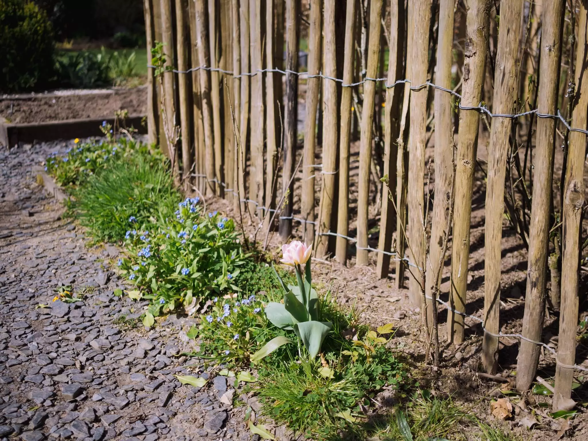
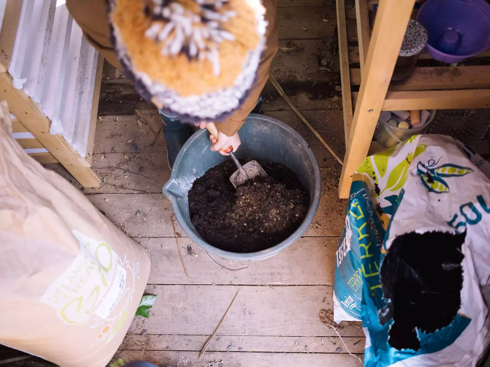
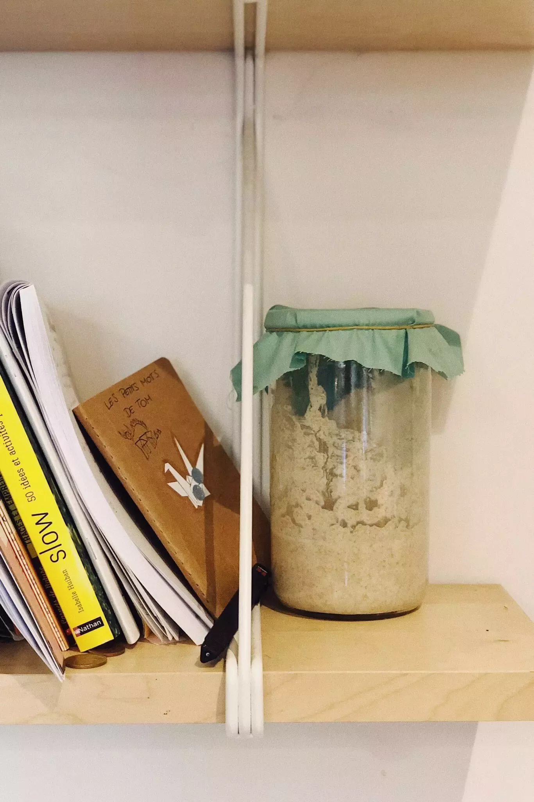

Se poser, respirer, ralentir. Il est 8h du matin, je fais chauffer la bouilloire pour le premier café de la journée. Je mouds les grains et commence le même rituel que tous les matins. Un moment privilégié entre moi, cette bouilloire et ces grains. Des moments lents comme cela, j’essaye d’en vivre plus.

En ces temps étranges, je pense que chacun doit repenser un petit peu son quotidien. Y insérer de l’inutile, du lent et du simple. Vivre pour vivre. Ne plus vivre pour produire. Se recentrer et apprécier. Mais au final, l’ennui est la solution dans tout ça. Ne rien faire. Faire pour faire. Faire pour soi.

> Vivre pour vivre

Je pense à de grands êtres du passé qui au final faisaient beaucoup mais lentement. Muir dans la Sierra, Thoreau à Walden. Et en faisant mon café le matin, je pense à eux et je ralentis, juste un petit peu. Le mix de confinement, école à la maison et mercerie nous force à ralentir, mais je suis certains qu’ils approuveraient.

Cette semaine, avec Tom, on a fait nos premiers semis. On a planté piments, courgettes et plusieurs plantes aromatiques. Un petit moment sympa sous les conseils de Cloé, c’était mes premiers semis sans être juste assistant. On verra ce que cela donne. On a aussi pris le temps de planter radis et carottes dans deux de nos carrés potagers.



Après avoir vu de plus en plus de monde faire son propre pain, dont une super recette chez [Grégory](https://gregorymignard.com/microposts/2020-03-28/), on s’y est remis aussi. C’était souvent Cloé et j’ai donc pris le temps de faire mon premier pain. Pris le temps de le pétrir à la main malgré la présence du Kitchen Aid. Mais le pain qui me fait toujours envie est au levain. J’ai donc suivi le super site de [The perfect loaf](https://theperfectloaf.com) pour commencer mon levain. On verra ce que cela donne.

J’ai aussi pris le temps de lire, même si mon cerveau est au ralenti un petit peu. Pris le temps de faire du café mais surtout pris le temps de perdre mon temps, pris le temps de m’ennuyer. Et cela faisait du bien.

Et vous, qu’avez vous décidé de faire autrement en ces temps? Hésite pas à [venir m'en parler sur Twitter](https://twitter.com/bonjouryannick) 🐥!
