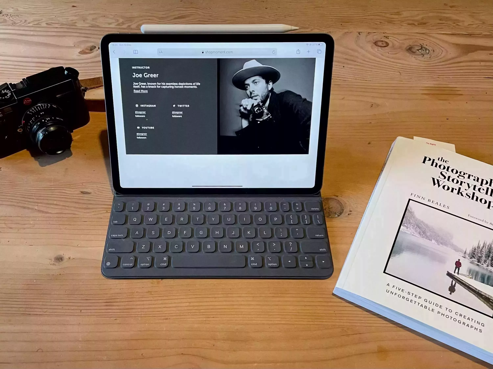
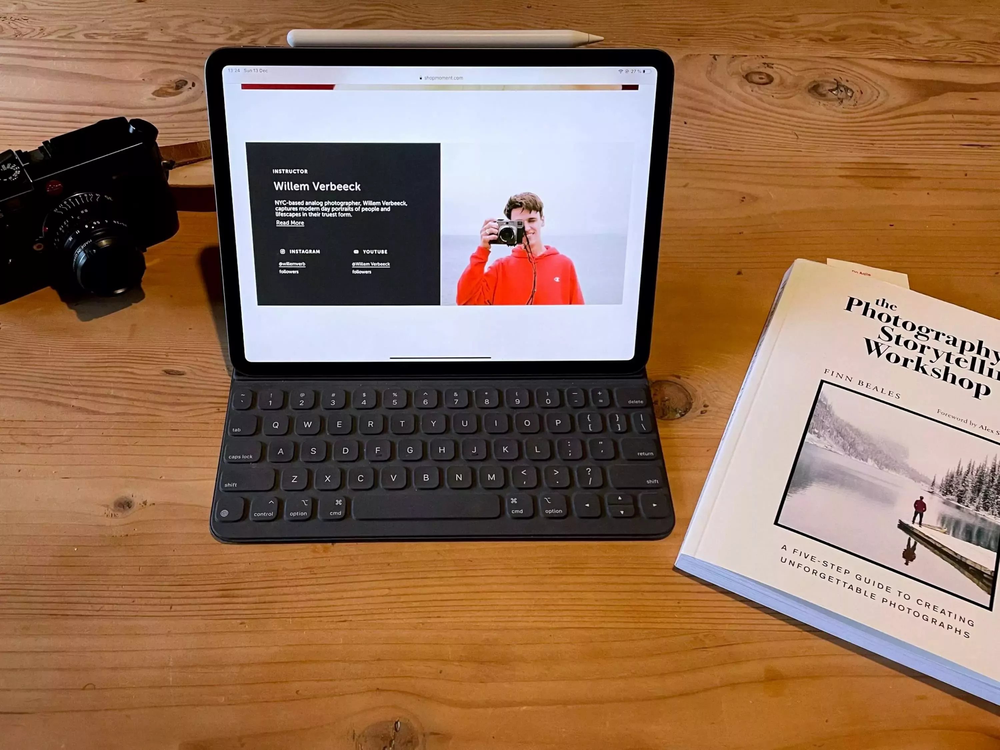

Cette année, j'avais pour but de renforcer mes connaissances en photo. J'en fais depuis un moment déjà, mais comme partout, l'apprentissage est infini. Je me suis dit que cela vous serait utile aussi et donc j'ai décidé de partager quelques sources utilisées cette année pour en savoir plus. Mon apprentissage s'est axé sur deux sujets. **Mieux raconter des histoires** en image et **mieux maîtriser l'argentique**. Il n'y aura donc pas de suggestions sur la compréhension basique de la photo.

## Le livre de Finn

J'avais regardé [son workshop chez Wildist](https://www.wildist.co/product/the-ultimate-photo-storytelling-workshop) et en plus d'être un fabuleux photographe et être humain, c'est aussi un super prof. Il a sorti un livre pour nous aider à améliorer nos photos, il est disponible sur [Amazon](https://www.amazon.co.uk/Photography-Storytelling-Workshop-unforgettable-photographs/dp/0711254702/). J'aurais préféré le trouver ailleurs que sur ce monstre mais bon, le livre vaut vraiment la peine. Il est un condensé de ses années de shoot. Il me permet de m'améliorer. Sur le flow du pitch, prepare, shoot, edit et deliver, il nous aide à ne pas se bloquer. Chaude recommandation!

## Workshop photo de Joe Greer

Je suis en train de regarder le [workshop Storytelling de Joe Greer](https://moment.8ocm68.net/rkjWR) produit par Moment. Ce n'est pas un workshop technique, mais on suit Joe dans un road trip et il explique son approche de la photo, sa façon de raconter des histoires en photos. Si vous ne connaissez pas Joe Greer, Il vit aux Etats-Unis, shoote principalement à l'argentique. Il est une des raisons pour lesquelles je voulais tant un Leica. Beaucoup d'autres raisons aussi j'avoue. Je le suis depuis un moment et c'est juste fabuleux. Son [Instagram](https://www.instagram.com/ioegreer/) est une vraie mine.  Sa façon de shooter la vie quotidienne est vraiment super inspirante. Je vous conseille ce workshop! Enfin, je me répète. Je ne vois pas pourquoi je mettrais une recommandation que je ne recommende pas.

## Workshop de Willem Verbeeck

Enfin, un workshop technique sur l'argentique. [Son workshop](https://moment.8ocm68.net/73eog) nous vient aussi de Moment et j'ai dévoré celui-ci. Il nous parle de tout pour parfaire nos photos argentiques. Cela va de la lecture de la lumière jusqu'aux tests de multiples pellicules en passant par son flow d'édition. Un workshop bien tassé avec des scènes magiques de nuit. Si vous ne suivez pas [Willem](https://www.instagram.com/willemverb/) je vous le conseille. Sa [chaîne Youtube](https://youtube.com/c/WillemVerbeeckFilms) est une vraie mine d'or pour les fans d'argentique. J'ai beaucoup aimé son comparatif de sur et sous exposition de ses films favoris. Vraiment un workshop à voir!

Voilà, c'est tout pour cette fois. Trois recommendations, une purement sur le storytelling, un mix et une pure sur la technique argentique. De quoi vous satisfaire tous. En photo, comme partout, il n'y a pas de destination, juste un voyage. Nous sommes faits pour apprendre toute notre vie qu'on le veuille ou non. Donc autant le vouloir!

*Ce post contient des liens sponsorisés.*
