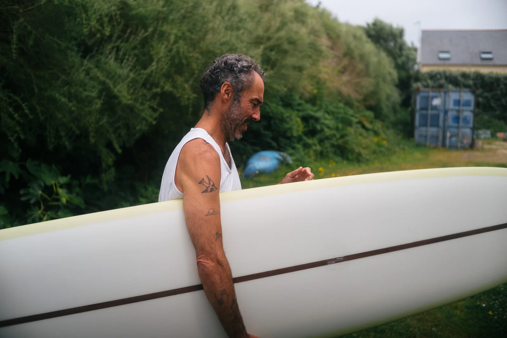
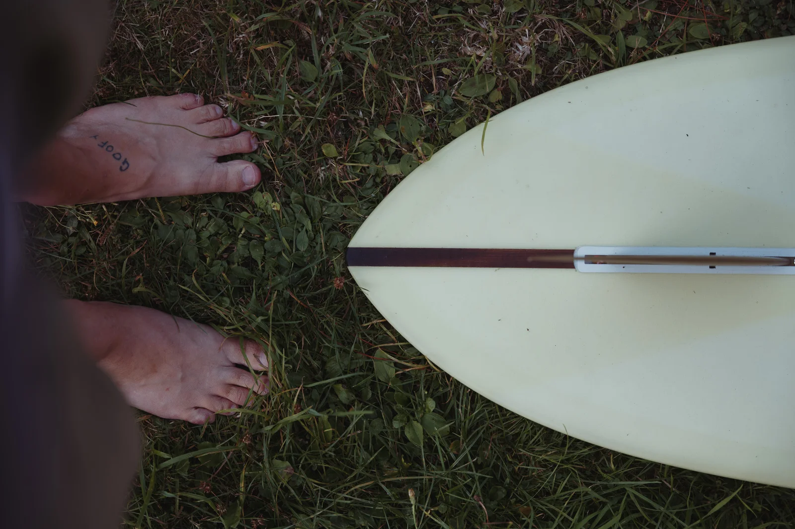

**First published on [Substack](https://bonjouryannick.substack.com/p/avocado-glider)**

Our favorite spot gets crowded over summer. I guess it’s the same everywhere now. We can call that a curse but in reality, we were all kooks some day. The crowd is still nothing compared to the south of France or countries known solely for surf travel, but it sure feels like it compared to our winters. Bretagne is on enough people’s maps now that whenever there is a bit of swell, the parking lots are full. And the ocean feels it too.

I wanted a new board for the summer waves.

I got invited this winter to sell prints during a market at Plume d’Avion, a shared space with other creators. This is where I saw his glider first. It was sitting behind all his boards and was magnificent. In the midst of spring, I saw the 10’2 he shaped for Jean. A beautiful canary yellow glider. This is when I knew I really wanted one. An 11’ Condor, avocado green by mistake, a resin order gone sideways that turned out perfect. A gliding machine hand shaped by Laurent at Plume d’Avion. And lord, that board flies.



Laurent has been shaping under the Plume d’Avion name in Bretagne way before it was that cool to be a surfer, I mean pre-covid. Can you imagine? And he has an amazing style. Inspiration comes from the alternative boards of the 60s and 70s. When I met him, I discovered an amazingly kind human being and we also connected around film photography.

Back to the board. I wanted something for really small waves, like less than knee high days. And this summer delivered that sometimes. Or nothing most of the time.

My first session with that avocado board was quite a disaster. Discovering new rails and how to position myself compared to the forgiving 9’6 I have. Also, finding where to lay on this one was a challenge depending on the waves. A lot of places are ok but some are better. Like any board I think, but once you have been surfing the same one for a long time, it takes a minute to adjust. But at some point, it clicked. Waves were tiny and I was gaining speed and trimming while foamies had a hard time even paddling in. Maybe this was due to the human operating the board and not the board itself.

Once you get it, you paddle easily and get into waves early. This is a great feeling. Then you just stand and stay somewhere in the middle of the board. Then you let it do its thing. It trims and speeds you up and all you do is stand and enjoy. I am often overthinking my take off and this one doesn’t let me do that. It is a switch off your brain kind of board. Stand and enjoy the ride.

Sure, I still have no idea where to store this glider. But thank you for the fun summer waves I wouldn’t have caught or considered otherwise!

