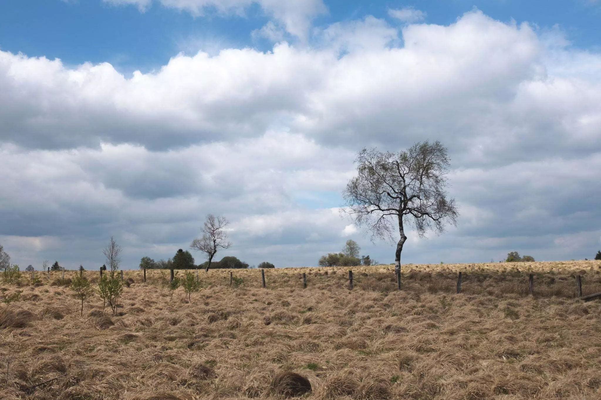
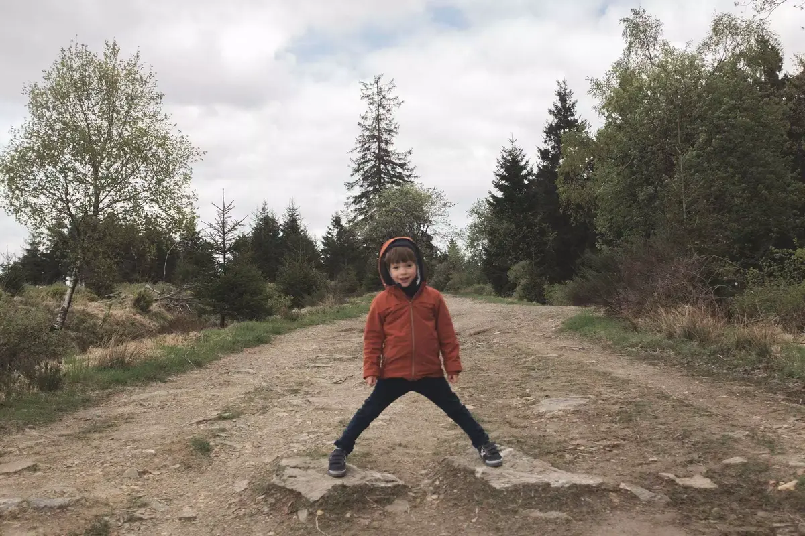
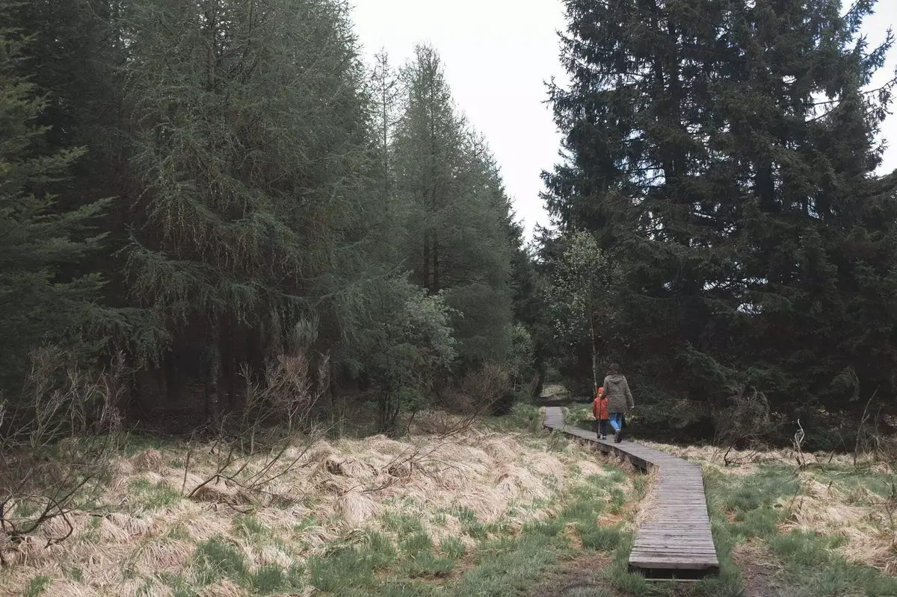
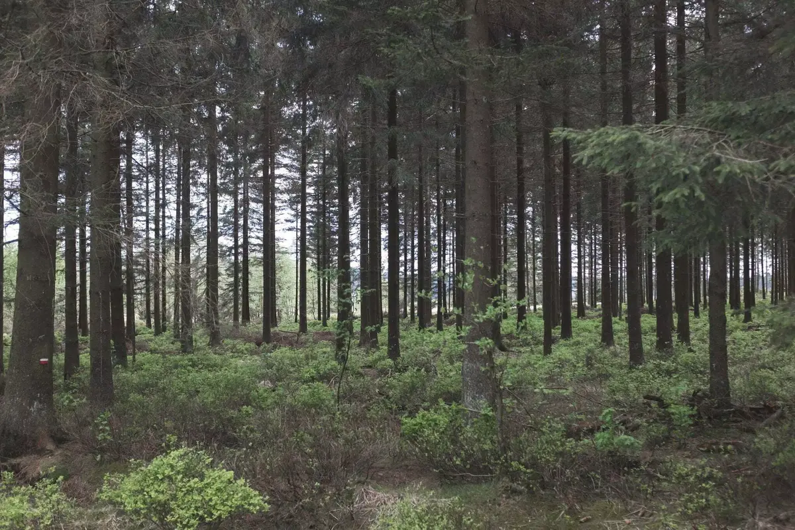
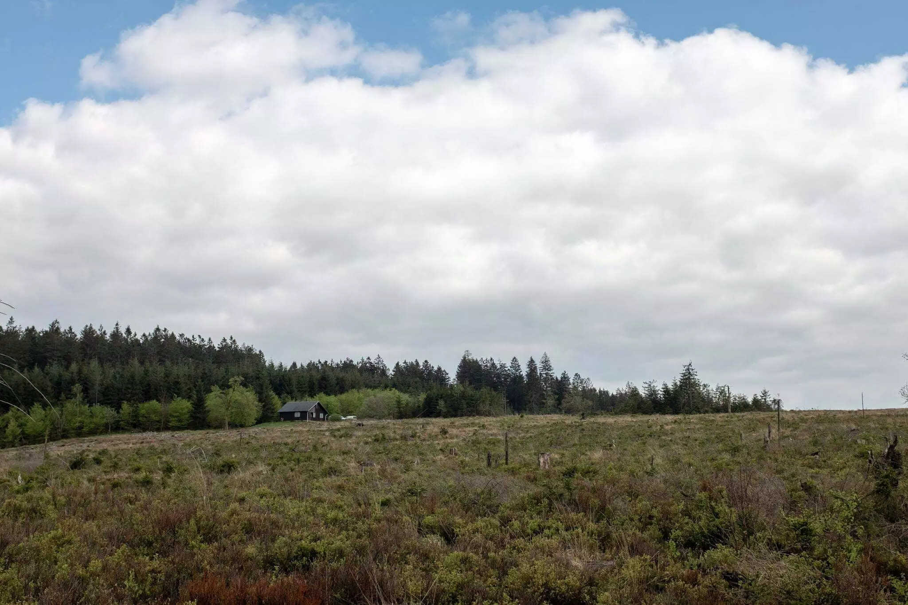

Cela fait quelques temps que l'on regarde cette balade. On a souvent fait la fagne de Pôleur. Tom adore les parties recouvertes de caillebotis. Cette balade autour de la Baraque Michel sera en partie sur caillebotis, en partie dans les fagnes et dans les bois.

On démarre en passant près du pré où nous avons fait des bonhommes de neige cette hiver. Le vent de face est rafraichissant mais j'espère qu'il ne durera pas trop pour Tom.
Les mains dans les poches, nous progressons. On observe les têtards dans les mares, saute au dessus des flaques et découvre aussi des petites sources.

Nous voici maintenant dans les bois, les premiers caillebotis font leur apparition. Tom nous sert de guide et ouvre la marche. Il adore et saute au dessus des trous où des planches manques.



Cloé et Tom font la course dans un coupe feu. On continue à suivre les rectangles verts. Cela nous fait faire un détour de deux bons kilomètres à travers un chemin plus boueux. Selon la balade voulue, on aurait du arrêter de les suivre. Ce n'est pas bien grave.
On finit par replonger dans la forêt surplombant la fagne de Pôleur. C'est un chemin accidenté mais qui nous amuse beaucoup. Une vue magnifique sur la tourbe. On rejoint les caillebotis en redescendant de la forêt. Un chemin qu'on avait déjà voulu emprunter mais qui était trop boueux en automne.



Au lieu de 7kms, on finira sur 9kms. Tom ne s'est plaint qu'un petit peu, il a finit sur mes épaules. Mais au final, il a du faire 10km à courir dans tous les sens. Une vraiment belle [balade de rêve](https://www.ostbelgien.eu/fr/fiche/hiking/balades-de-reve-13-fagne-de-la-poleur).

