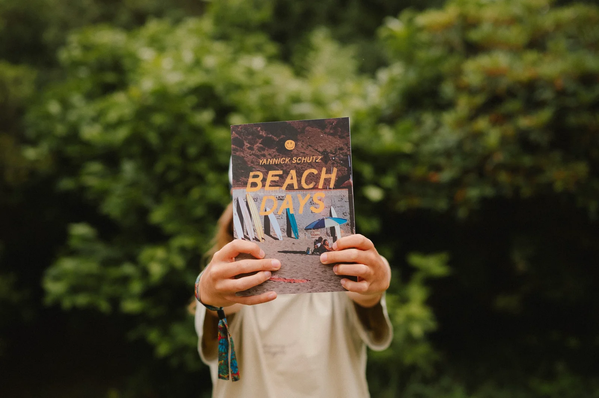
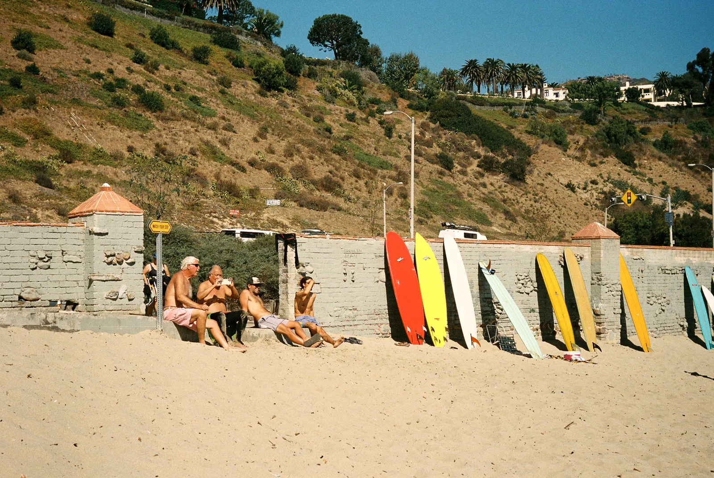
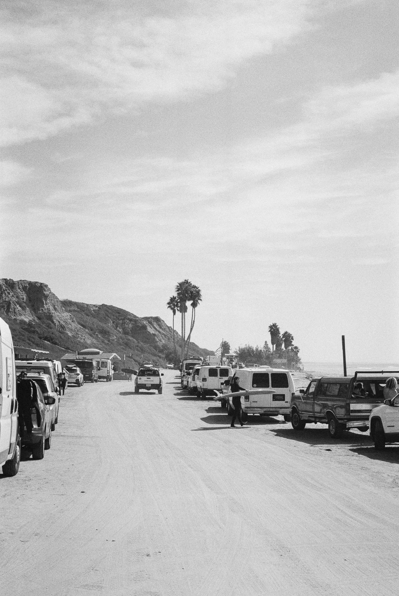

**First published on [Substack](https://bonjouryannick.substack.com/p/beach-days)**

Beach Days is that mix of sand, wax and sun that we all crave every summer.  
It is part of my endless summer in California.  
I have documented our journeys from Santa Cruz to San Onofre and decided that part of that needed to be enjoyed as a printed thing.  
This is it.

Many rolls were sent to my favorite labs. And the results started to show some path and similitude every time I came back to some places. This led me to the selection for the exhibition. But of course, I had too many pictures. Some were fillers, other were amazing shots that didn’t make the cut. But I love to print stuff so I made a zine to share them all.

A few days at San Onofre just makes you want to move there permanently.

The wall at Malibu before the fires have that amazing nostalgic feeling. I am sure the feeling might already be back but we shall never forget that earth is in command.

When some lights just hit surfboards perfectly and you hope you nailed the shot.

Those are a few of the feelings I hope you will get while watching the pictures or turning the pages of the zine.

I am quite pleased with the result. I hope I will get many eyes on both the zine and the exhibition. I hope I will find other places to show this set later on. If you are interested or know a place, please tell me.

The pictures are visible at Chez Lucette in Brest. You can find more information about that amazing small coffee shop here: [instagram.com/lucette.cafe](https://www.instagram.com/lucette.cafe/). The zine can be found at [yannickschutz.com/shop/beach-days-zine](https://yannickschutz.com/shop/beach-days-zine) Get it while it is still available.

On a technical note, I had the chance to play with [Matt Allen fonts](https://www.instagram.com/handdrawnfont/) for the zine. And I must say, those are amazing! The SVG fonts are amazing to use, I cannot wait for Affinity to support those.

