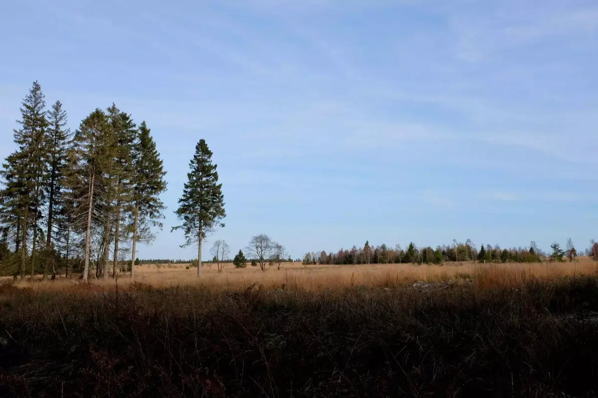
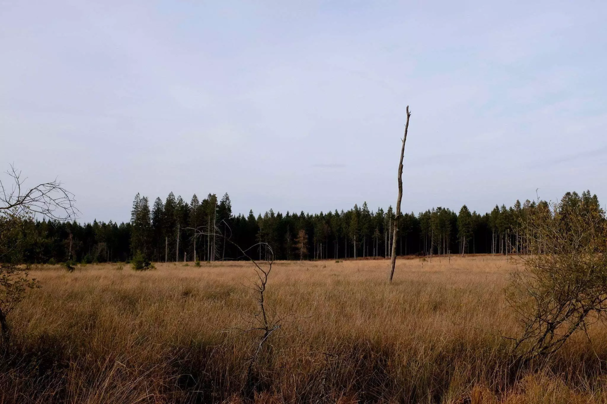
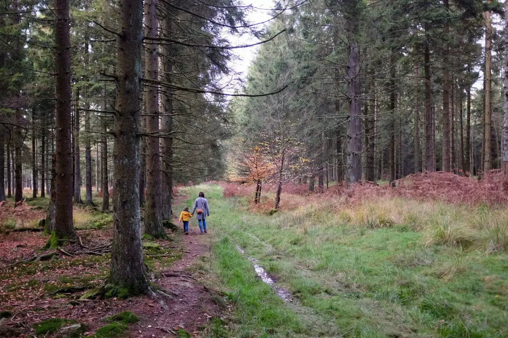

Lors de notre dernière balade au Signal de Botrange, nous passons devant la porte de Drossart, on y voit des voitures et on se dit que l’on doit y revenir. Voici chose faite. Plusieurs balades au départ allant de 2 à 8km sont possibles. On a environ deux heures devant nous, on choisit celle de 4km. Suivons les rectangles verts.

  

Nous commençons par une marche sur un chemin parallèle à la route qui nous amène auprès d’un carrefour bordé d’une cabane en bois. 4 ou 7km, le choix peut encore être fait. Notre chemin longe un petit court d’eau, il fait trop froid pour y tremper les pieds mais en été, le remonter peut être rigolo pour un enfant. De l’autre côté, des petits étangs, souvenirs des guerres, qui sont en réalité, des trous d’obus. Une bombe qui aura amené un vrai petit biotope avec le temps.

Au bout du chemin de sapins, nous voici dans la fagne. Avec le soleil assez bas, elle a de magnifiques reflets dorés. Nous montons sur un sentier de caillebotis, juste assez large pour une personne, des endroits sont aménagés pour les dépassements et croisements, un vrai plaisir pour Tom.

Un croisement, notre rectangle vert est dur à repérer mais l’autre direction est un cul de sac. On s’enfonce dans les hautes herbes et bruyères hors du caillebotis pour rejoindre la forêt. On comprend mieux la petite note au départ suggérant le port de bottes. De la boue partout, cela fait le bonheur de Tom. Nous cherchons des passages moins humides en évitant le chemin et en entrant dans le bois. On détecte des traces d’animaux mais on n’en croisera aucun. La balade se termine en fermant la boucle.



On reviendra pour faire la grande boucle qui semble longer la fagne. Cette boucle semble être accessible aux poussettes. On y retournera peut-être une fois les premières neiges pour voir un paysage différent.




### INFORMATION

Durée: 1h30

Distance: 4km environ

Prévoyez des chaussures imperméables ou des bottes.

<iframe data-card-recommend="0" data-card-recommend="0" data-card-recommend="0" data-card-recommend="0" src="https://www.google.com/maps/d/embed?mid=1xhzME2KfgwVwYXQeOJh2EFe4MvZXEiva" width="100%" height="480"></iframe>

