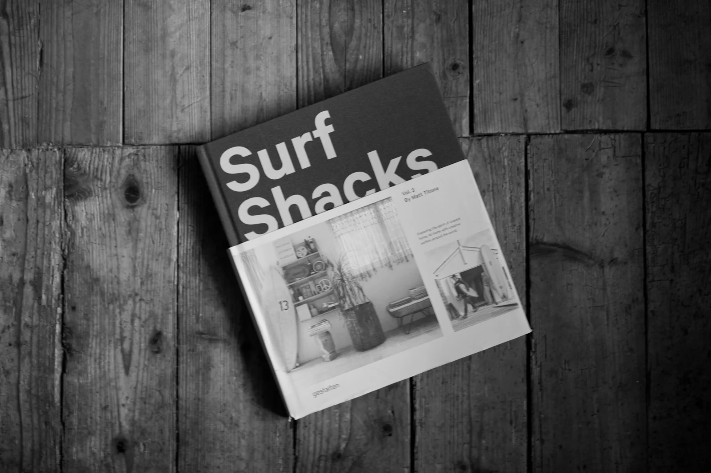
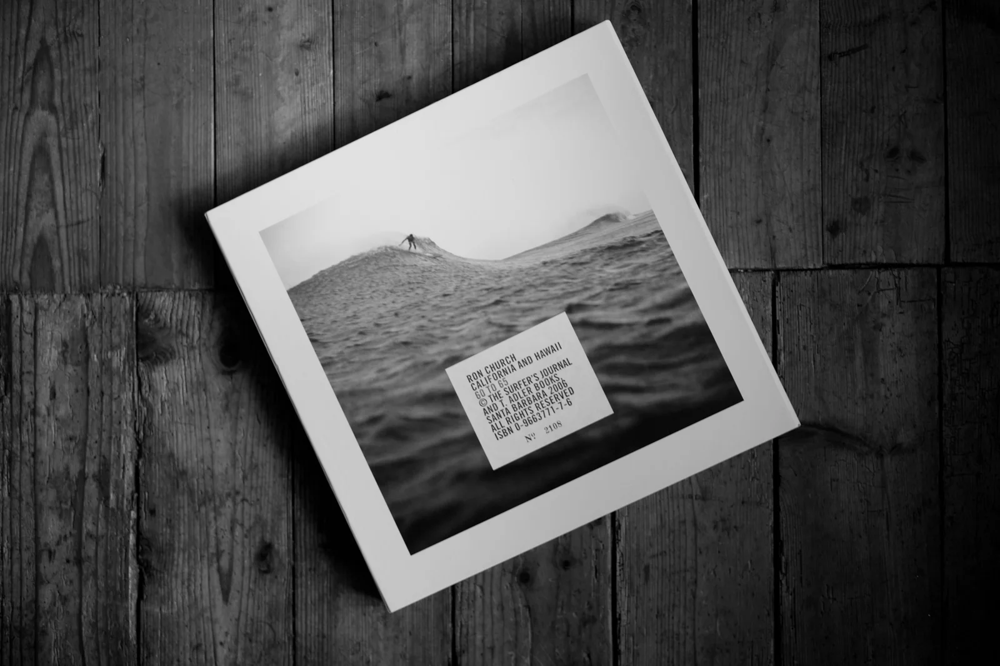
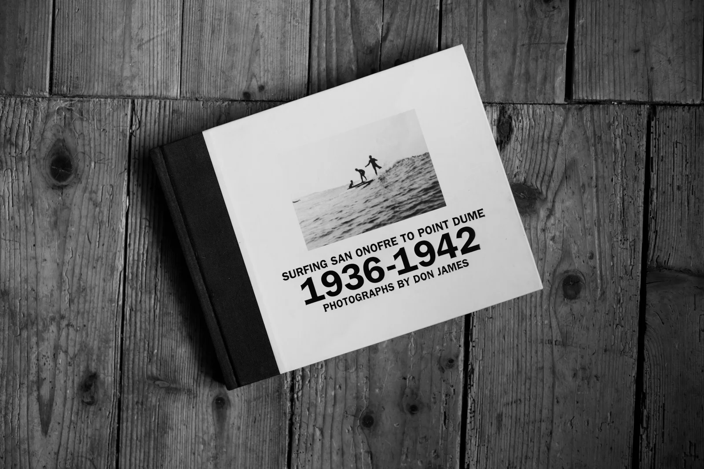
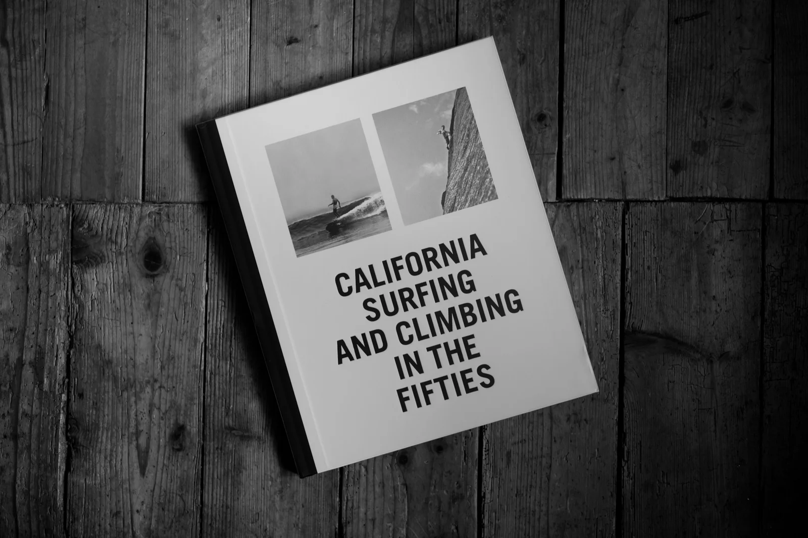
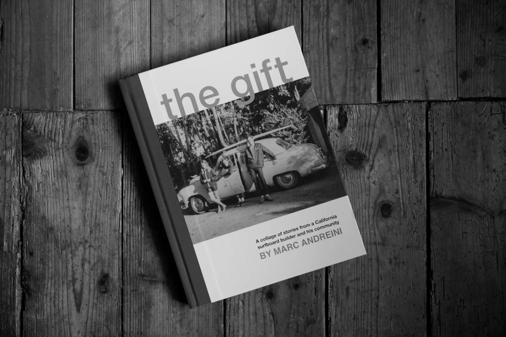

**First published on [Substack](https://bonjouryannick.substack.com/p/flat-summer-full-shelves)**

We didn’t have a lot of waves over the summer. That allowed me to dive back into some inspiration books I have here and that I love. I’ve been a book collector for quite a while. And over the summer, I found new ones or revisited old ones.

Time to share my recent favorites. A lot of my recent pickups are books published by [T. Adler](https://tadlerbooks.com/). I have a passion for beautiful books and I still want to publish my own hardcover someday. Still too early for that I guess, but a lot of my inspiration comes from there.

## Indoek Surf Shack Vol. 3

This book is a masterpiece. I discovered [Matt Titone](https://indoek.com)’s blog early on and quickly came to the books when I started surfing. I had the chance to visit his gallery a few times. I have a keen interest in interior design too. And seeing the places he was presenting was an inspiration. This felt like dressing like your favorite skaters as a teenager, but next level. The people in this book are always super interesting. And the houses, well, I wish I was living in all of them.

## Ron Church - CA/HI 60 to 65

An amazing book of pictures spread between California and Hawaii. Early 60s. Ron Church is one of those pioneers. Photographing the California surf life and culture. The book itself comes in a case and is a piece of art from T. Adler. The pictures are separated in two sections. First California, then Hawaii.

## Surfing San Onofre to Point Dume 1936-1942 - photographs by Don James

I found this one second hand for a ridiculous price. I had to order it. I made a \[small zine\](https://yannickschutz.com/shop/san-onofre-zine/) about the few times I spent at San Onofre. That place is special. It has the vibe. And that pre-war surfing book is just a great source of inspiration. Another T. Adler book. You feel it just by looking at the cover. The inner design is simple but damn effective.

## California Surfing and Climbing in the Fifties

Yet another T. Adler book. You are split between the good surfing places of California and the amazing climbing spots. From Malibu to Yosemite. You get to witness the heroes of that time. I just love those books from the 50s and 60s. There was some kind of freedom and discovery that now feels harder to reach. Having spent time in both places, it is great to see those from the eyes of the early days pioneers.

## The Gift, by Marc Andreini

I discovered this one thanks to [Jorge](https://www.instagram.com/jorge_hunt/) and [Pat](https://www.instagram.com/melloyello_guesthouse). Marc Andreini is a world famous shaper. And the stories told in this book walk you through the modern history of surfboards, and so many pictures documenting that whole life. So many good stories. I haven’t finished reading this one but I am enjoying it a lot. Many people writing, many shots. A great collage of a book.

