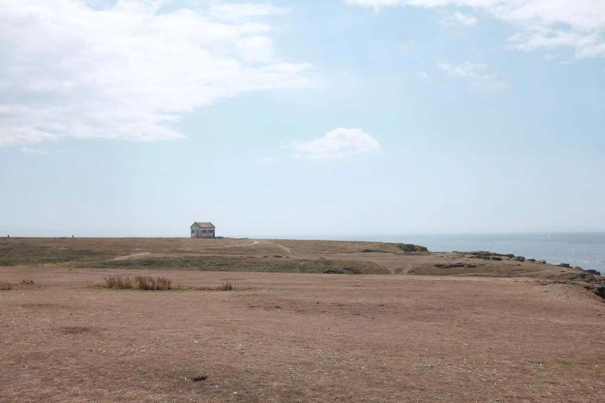
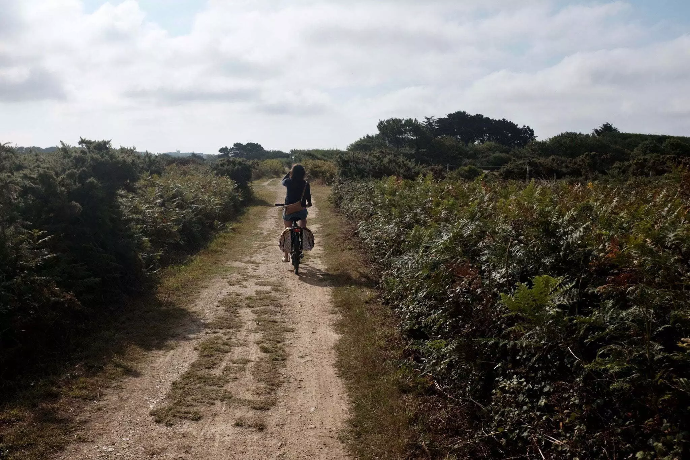
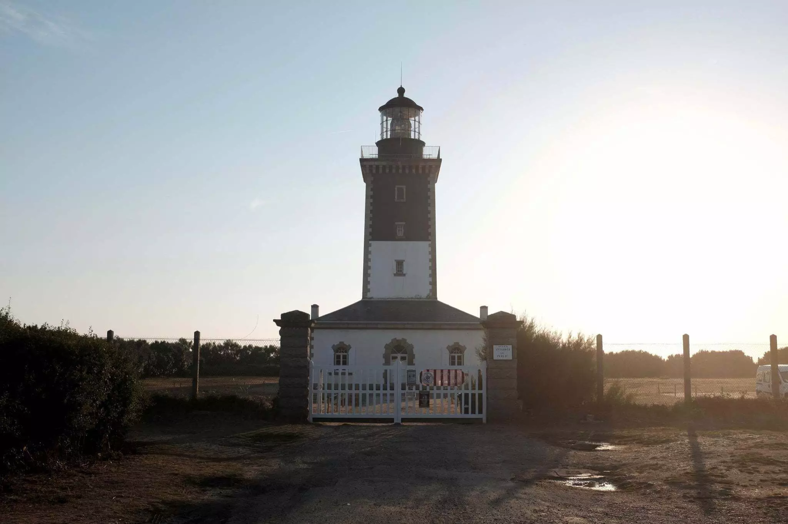
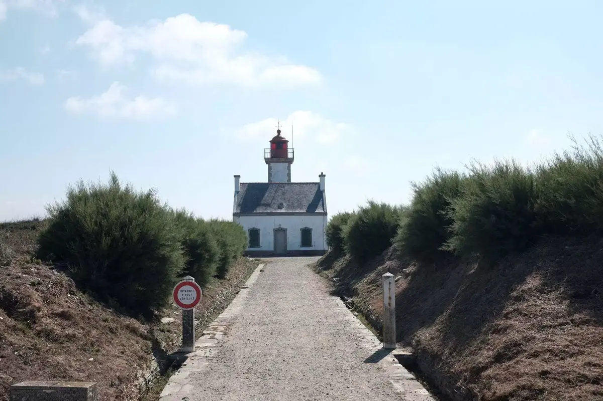
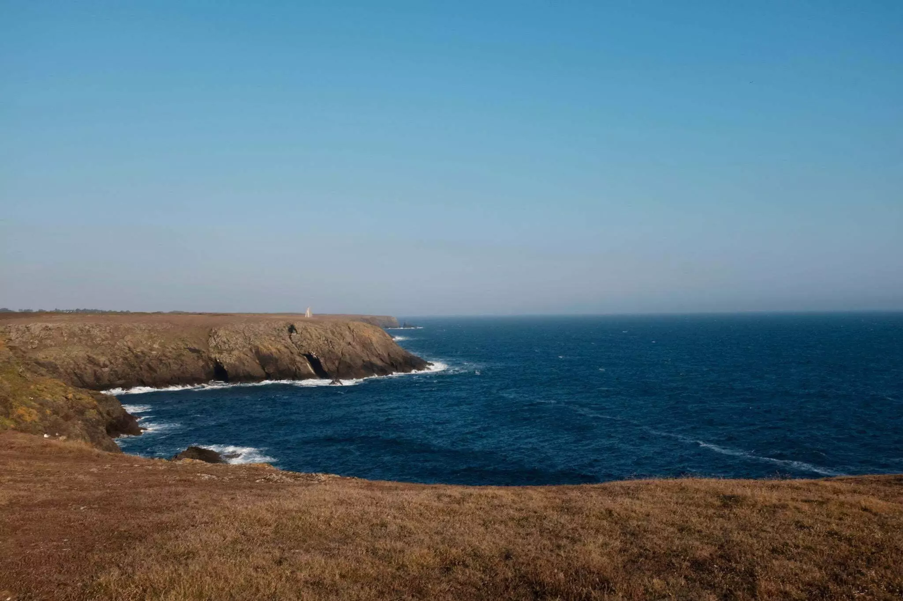
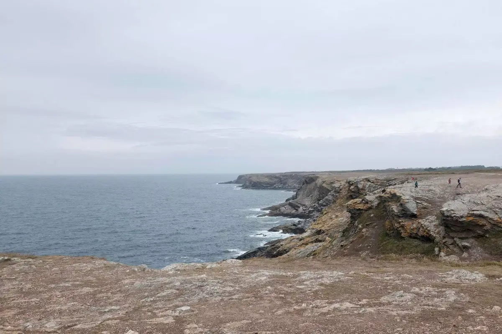
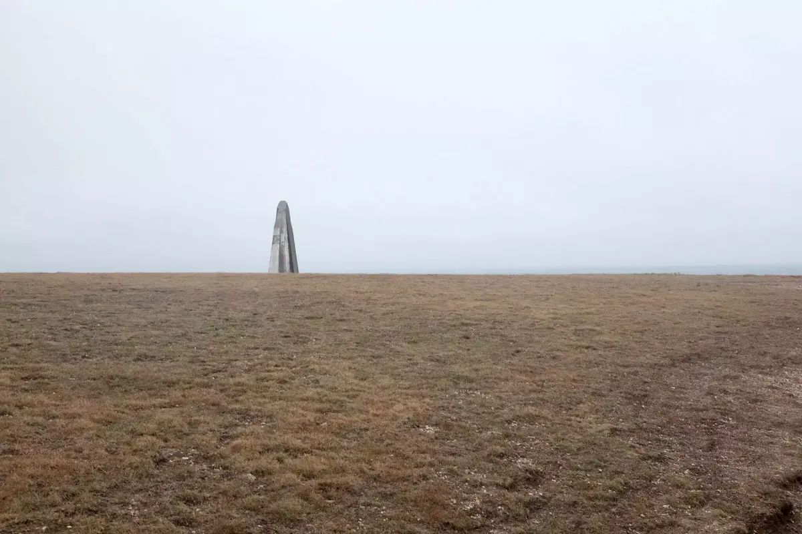
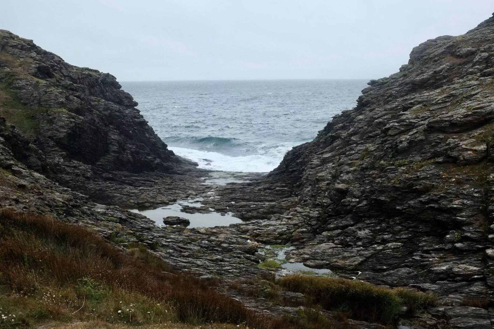
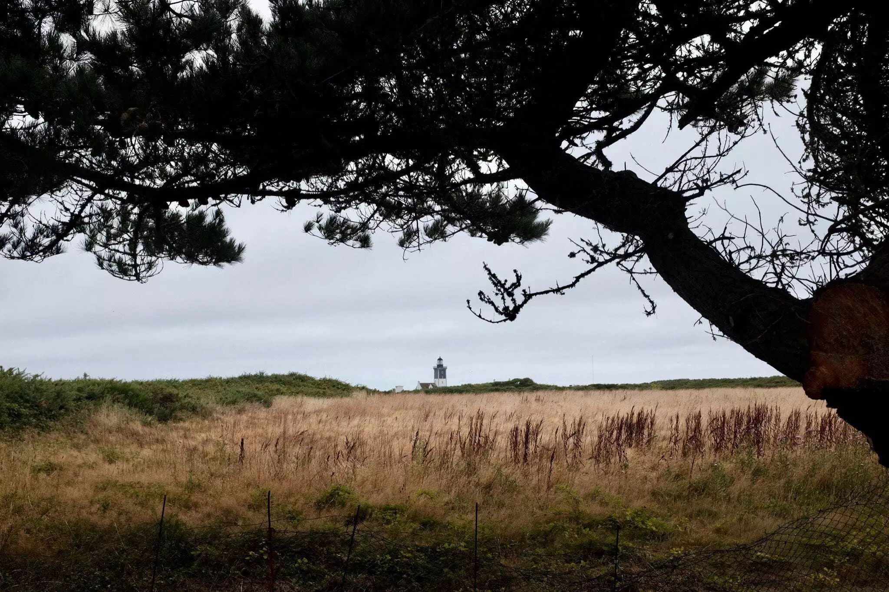

Pour nos vacances, On trouve un airbnb sur une petite île bretonne. On se dit qu'on ne va pas passer des mois à se décider, on le loue et en trente minutes nous voici prêts. Les vacances ne viendront que quelques mois plus tard, nous permettant de prévoir tous les petits détails: la traversée en bateau, les étapes pour ne pas se fatiguer trop avec un petit bout, avoir un porte vélo pour profiter de l'île en deux roues, ...

Nous roulons jusque Lorient et embarquons la voiture sur le ferry. Nous pouvons monter sur le pont et profiter de la traversée, l'île grandit et nous débarquons, notre maison se trouve au bout de l'île. Nous sommes effectivement la dernière maison avant le phare.





Cette petite île, face à Belle-Île-en-Mer, nous semble suffisamment petite pour n'être que visitée en vélos. Nous apprendrons à nos dépends que le vent de face et le faux plat au retour du bourg est plutôt coriace avec notre manque de pratique. Pour les courses, nous prendrons la voiture. Le reste se fera à vélo!

Il est possible de faire le tour complet en une journée sur la petite reine. Un parcours d'environ 30km qui fait découvrir toutes les petites plages et villages de l'île. Si vous voulez longer la côte, certaines parties ne sont pas accessibles aux deux roues. Les balades à pieds sont aussi un vrai plaisir.



La météo ne sera pas radieuse mais parfaite pour des longues balades durant toute la semaine. On pourra même en profiter pour se baigner dans l'océan sur une des rares plages convexes du monde. Oui madame, vous avez bien lu, au lieu de rentrer dans les terres, celle-ci rentre dans la mer.



Nous partagerons notre temps entre de belles balades sur les falaises, laisser le cerf-volant s'envoler avec les vents marins ou à aller cueillir des mûres sur les sentiers. On reviendra même avec nos confitures faites avec nos petites mains, malgré que cela soit la spécialité.



Nous découvrons grâce aux bons conseils de nos hôtes de très chouettes petits restaurants, toujours aux bons soins pour notre petit bout aussi. Nous trouverons aussi de jolies petites plages quasi inaccessibles sans avoir les conseils des locaux. Cette toute petite île nous a charmé, les autochtones sont des gens forts sympathiques, on aurait envie d'y rester plus longtemps.

