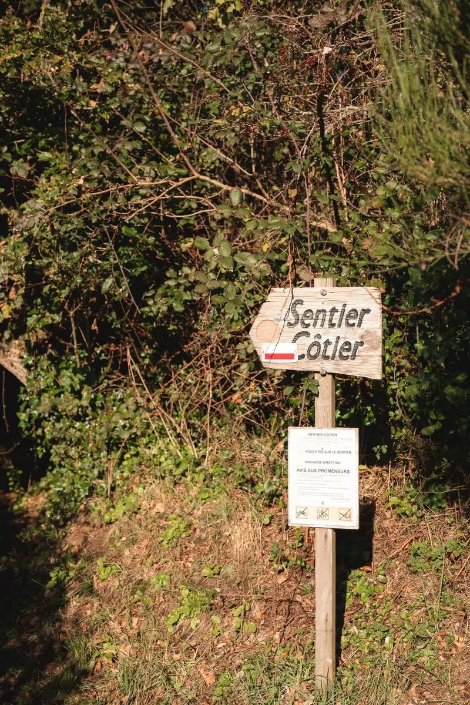
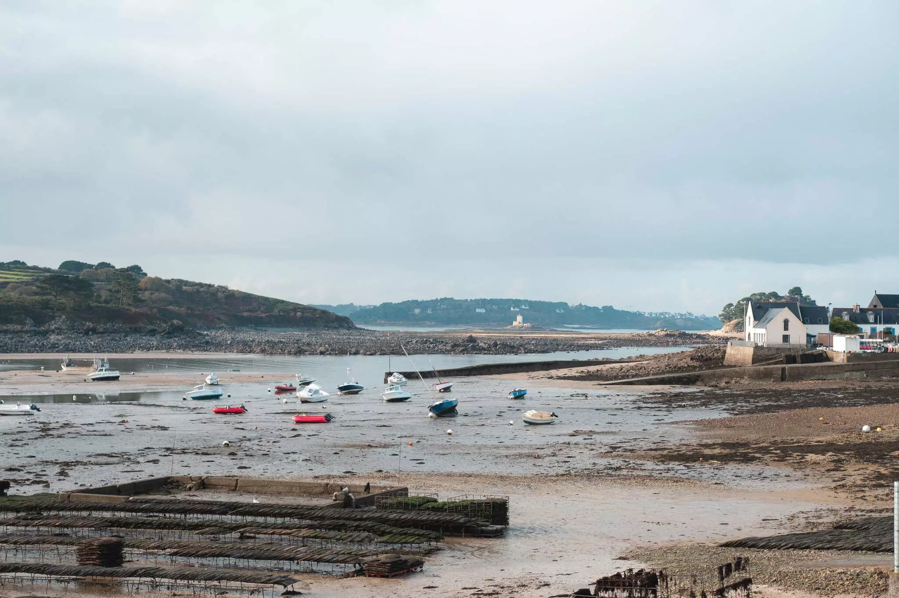

On était en bord de mer pour l'anniversaire de Cloé hier. À un moment, elle me dit quelque chose du genre: "Si tu m'avais dit y'a un an que je fêterais mon anniversaire en marchant le long de la mer, je t'aurais ri au nez." Cette phrase a juste déclenché un flux de pensées.



Il y a un an, on ne savait même pas que cette maison existait. Elle ne savait pas non plus que l'on existait. On ignorait encore que notre futur se ferait dans le Finistère. On regardait toujours des maisons en Bretagne et en Bourgogne. Ce jour d'hiver où j'ai découvert Ty Lucie au détour d'une recherche web n'était pas encore passé. On ne savait pas encore que le frigo faisait ce bruit de poulet de temps en temps. Ni que les tuyaux de chauffages faisaient ce drôle de bruit, ni que le bois craquait pendant que les tuyaux chauffaient. On ne savait pas encore que notre voisin serait une chouette et qu'elle nous saluerait une fois la nuit venue.

On n'avait pas idée que ce magnifique brouillard se joindrait à nous sur le chemin de l'école de Tom. Aucune idée non plus que nous aurions des vaches comme voisines. Que les nuits seraient noires et que notre routine nocturne inclurait de regarder les étoiles.

Qui aurait cru, il y a un an, que je prendrais plaisir à remplir notre panier de bois pour le poêle de la cuisine ou à couper du bois pour l'allumage ou même que je prendrais du plaisir à jardiner.

Des choses simples me font tellement plaisir. Comme promener le chien dans le village et saluer les personnes... et elles vous répondent. Ces choses-là me font me sentir bien.



Déménager signifie aussi être plus conscient des amitiés. J'étais un peu à côté de la plaque dans le passé. Maintenant, je me reconnecte et j'écris plus à cause de la distance. Je dois encore me perfectionner. Mais la pratique est tout ce qui compte.

Ces 10 kms en bord de mer m'ont certainement fait penser beaucoup et rendu heureux. Je ne me suis jamais senti aussi bien. J'apprécie chaque minute de cette nouvelle vie, même les plus difficiles.


