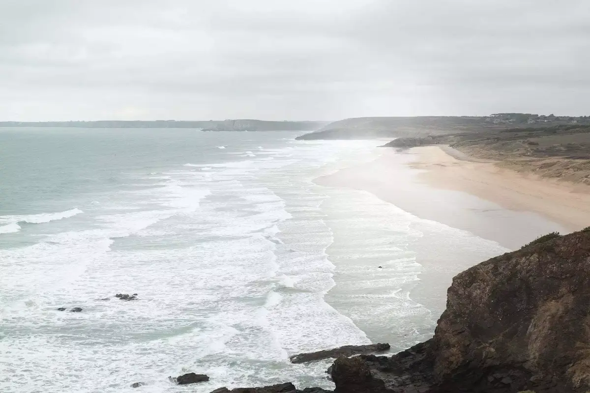
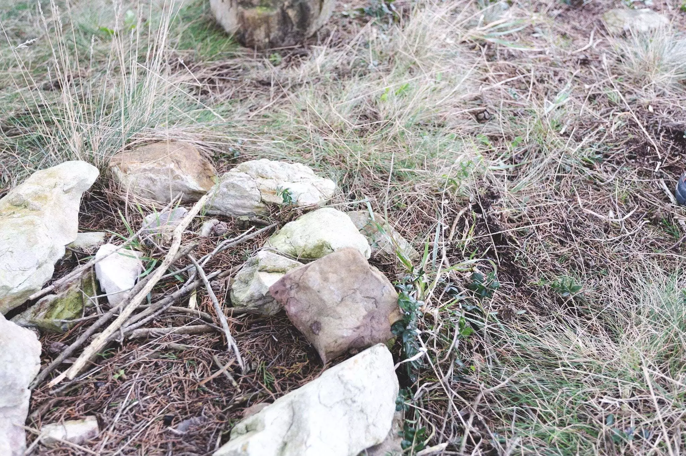

On continue les découvertes des chouettes lieux de la Bretagne. Cette région n'a toujours pas tout montré, pas même 10% je pense. On adore continuer à la découvrir! On espère aussi faire de chouettes rencontres humaines cette année pour découvrir des lieux secrets. Cette fois-ci, c'est la plage de la Palue sur la presqu'île de Crozon. Un vrai petit coin de paradis sur terre encore une fois.



Comme parfois, la météo n’était pas des plus clémentes. On arrive, on se gare, une combi de surf sèche sur le van à côté de nous. C’est sûr, on est au bon endroit. Cette plage est connue pour son surf. On croisera un allemand venu se poser quelques jours avec son break pour maison et la mer comme terrain de jeu. On descend vers la plage. On croise un véliplanchiste courant vers l’océan. L’appel de la mer, je suppose.

On marche dans le sable pour rejoindre le GR34. Le chien s’amuse avec les algues et se fait un petit casse-croute. On grimpe sur les falaises et admire la vue. C’est magique et envoûtant. La force des vagues, la beauté de l’eau qui claque sur la falaise. Le va et vient des vagues le long de la plage. Le bruit de l’eau.

On grimpe encore et on se balade, on se perd dans les petits sentiers. Sur leurs bords, des murets de cailloux. On se pose, on pique nique. On passe par les petits villages le long de la côte pour rejoindre notre point de départ.

Une balade qui nous donne envie de revenir. On trouve un airbnb pour revenir lors des plus grosses marées. C’est dans une semaine. J’ai hâte. L’appel de la mer, je suppose.

