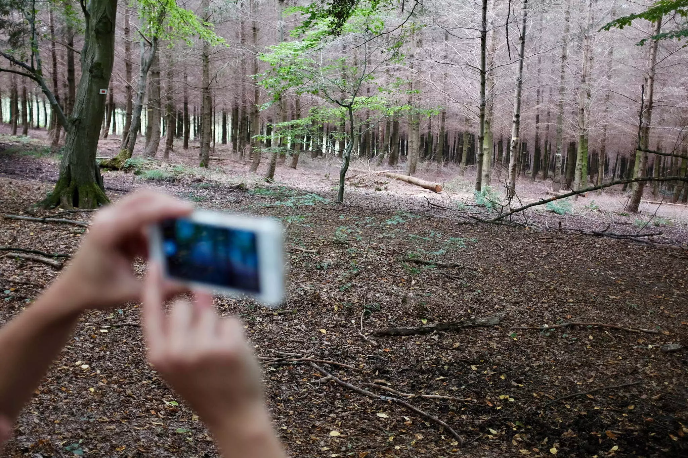
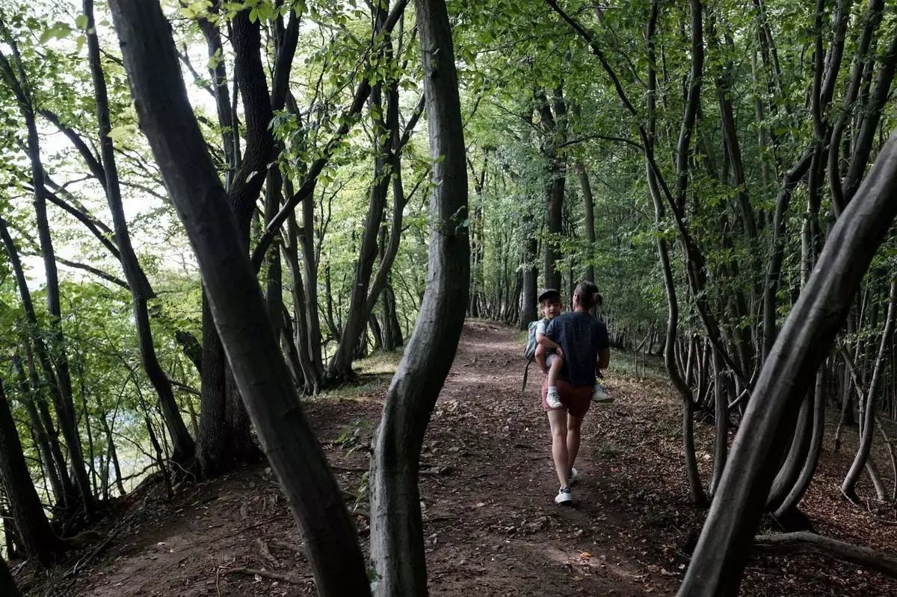
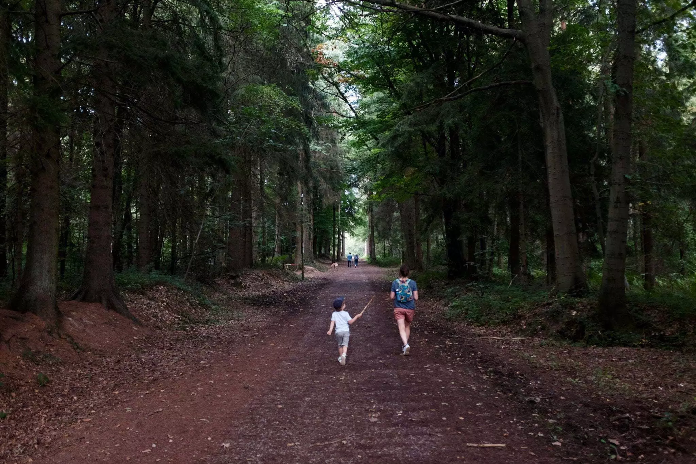
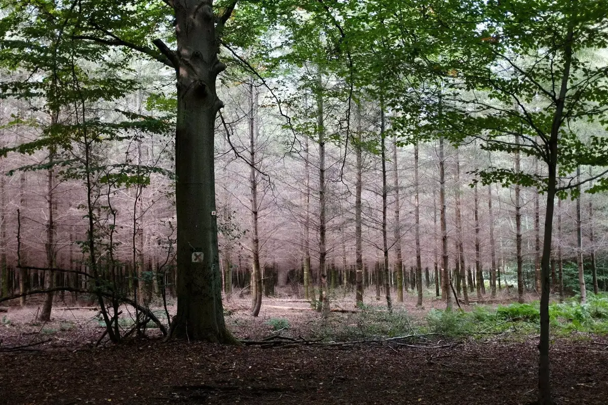
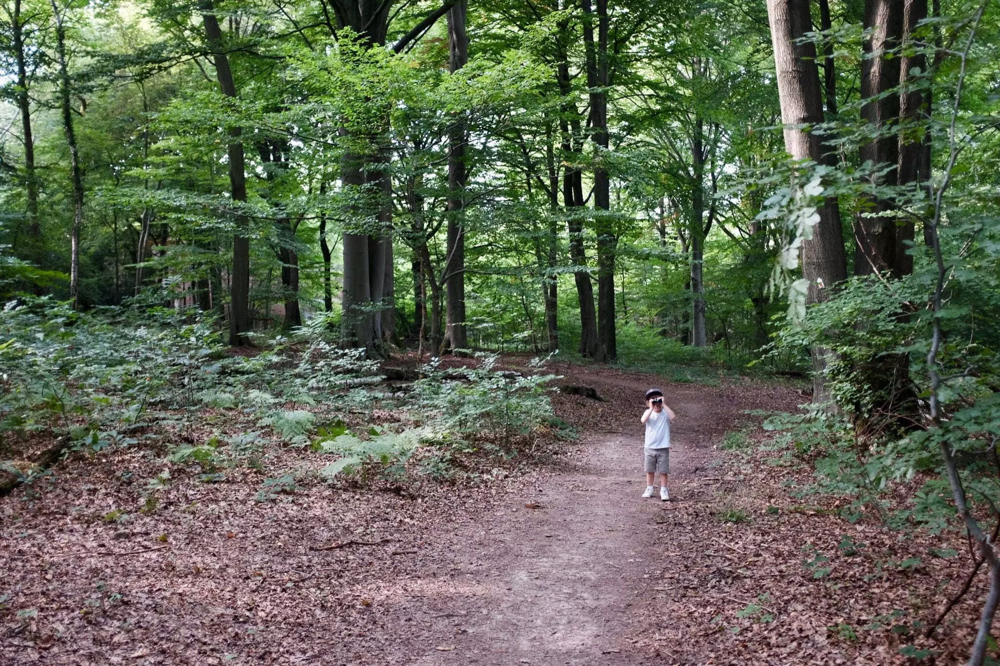
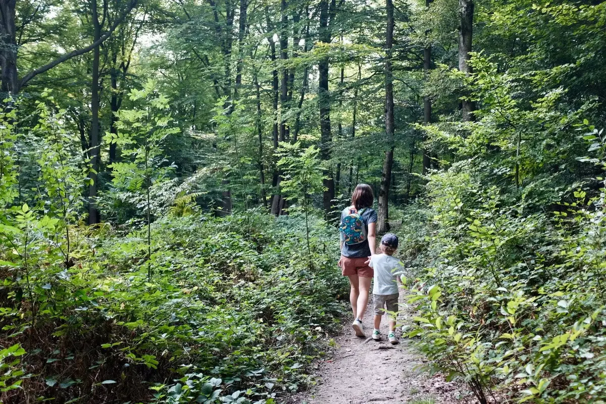

On est arrivé là un peu par hasard. On avait prévu de faire le Ninglinspo ce jour là mais apparement on était pas les seuls. Une petite recherche pour voir si une belle balade à la roche aux faucons est faisable et nous voilà en route.

On a l’impression de se garer chez les gens en y arrivant. Ce n’est pas le cas. On traverse, passe le long d’une maison et on se lance sur les bords de la falaise. Une vue assez impressionnante sur la vallée où serpente l’Ourthe s’offre à nous. J'avais déjà entrevu la roche depuis le Ravel mais le paysage depuis la falaise est bien plus impressionnant.



On est le long d’un chemin entouré d'arbres. La balade dans les bois peut se prolonger mais on a peu de temps et décide de couper. La carte semble nous le permettre, on arrive le long d’une petite route que l’on suivra jusqu’à pouvoir re rentrer dans la forêt pour finir la boucle.



Cette partie boisée offre quelques installations que l’on peut louer sans doute pour faire un bon barbecue ou fêter un anniversaire. On y croise pas mal de monde au départ mais en continuant, on retrouve la quiétude de nos forêts.

On s’amuse un peu avec les jumelles de Tom et avec des bouts de bois. On se retrouve face à une parcelle de feuillus teintée de rose. Je ne sais pas à quoi est due cette couleur ni que sont ces arbres. Mais une chose est sûre, c’est envoutant et magnifique.

### INFORMATION

Distance: 5.36km

Durée: 2h

<iframe data-card-recommend="0" data-card-recommend="0" data-card-recommend="0" data-card-recommend="0" data-card-recommend="0" data-card-recommend="0" data-card-recommend="0" scrolling="no"  data-card-recommend="0" src="https://www.google.com/maps/d/embed?mid=1JlEh4zfnQmXykqjUp1gdIFe6GqFmrzCI" width="100%" height="480"></iframe>

