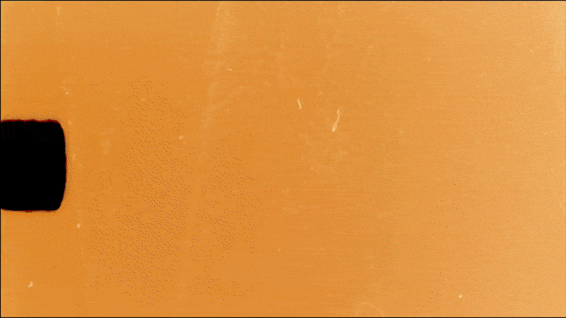

Apprendre le surf quand tu as passé la trentaine et que tu vis à une heure de la côte, c'est un choix. Un choix pas toujours simple, mais un choix quand même.
C'est le genre de choix qui t'avale tout cru comme un jour de gros à Nazaré (Dans les plus grosses vagues au monde pour ceux qui ne savent pas).
C'est beaucoup d'essais erreurs.
C'est de l'eau de mer qui te sort des narines alors que tu es sorti de l'eau depuis des heures.
C'est un rituel de nettoyage/rinçage de combi après chaque session.
C'est apprendre à enfiler et retirer une seconde peau quelles que soient les conditions et l'endroit.
C'est risquer de vomir la première fois que tu as cette peau qui te sert le cou.
C'est mater plein de vidéos pour essayer de comprendre et analyser le truc.
C'est prendre plein de cours et voir ton fils y arriver mieux que toi.
C'est avoir tout à apprendre et l'accepter.
C'est comprendre le localisme et les multiples codes qui régissent les spots.
C'est apprendre à lire les apps de prévisions et accepter que c'est pas toujours assez.
C'est aimer voir la webcam sur ton spot mais comprendre qu'en fait elle tue un rien le charme de l'apprentissage.

C'est comprendre qu'une gauche va vers la droite quand tu es face à la mer.
C'est savoir qu'offshore c'est mieux qu'onshore, mais que quelques soient les conditions, tu apprends toujours, donc au fond, on s'en bat lek.
C'est découvrir pas mal de muscles qui n'avaient pas bosser depuis longtemps.
C'est vouloir les muscler et aimer le sport de plus en plus.
C'est attacher des logs de trois mètres sur le toit de ton Berlingo.
C'est voir ce Berlingo en star dans un article japonais.
C'est être humble.
C'est être ouvert à tous.
C'est un foutu monde qui sent bon l'iode et la wax.
C'est une odeur de pieds horrible un matin d'hiver dans ta salle de bain.
C'est plein de bouquins magnifiques, d'artistes dingues et d'art à faire pétiller les yeux.
C'est entendre parler de super conditions et adorer surfer des petites vagues.
C'est une question de déséquilibre maitrisé.
C'est pas que des blondinets bronzés.
C'est pas que des grosses manoeuvres, ni Philippe Manoeuvre.
C'est de plus en plus intense et comme une drogue saine.
C'est accepter la frustration de rater un jour de bonnes conditions.
C'est accepter de tout lâcher pour juste prendre deux vagues.
C'est rencontrer plein de gens passionnés.
C'est parler une heure sur le parking avec un gars sans même demander son prénom.
C'est avoir son rail qui se cale sur la vague.
C'est sentir la glisse.
C'est comme un psy sans besoin de remboursement.
C'est quelques aller-retours vers la côte pour peu de vagues mais pour une paix et un bien-être qui n'a pas de prix.

