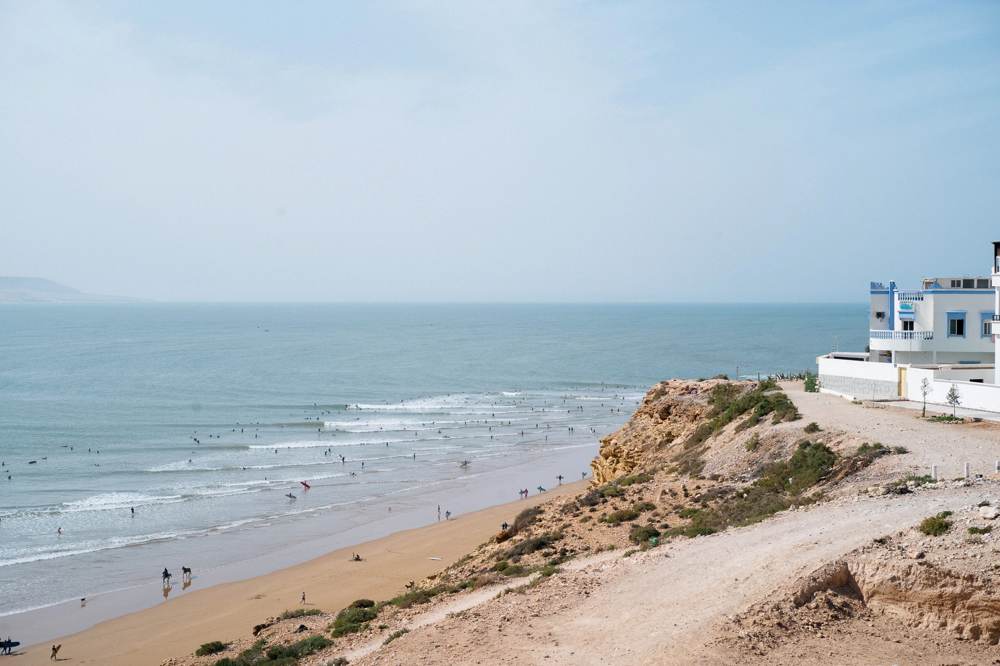
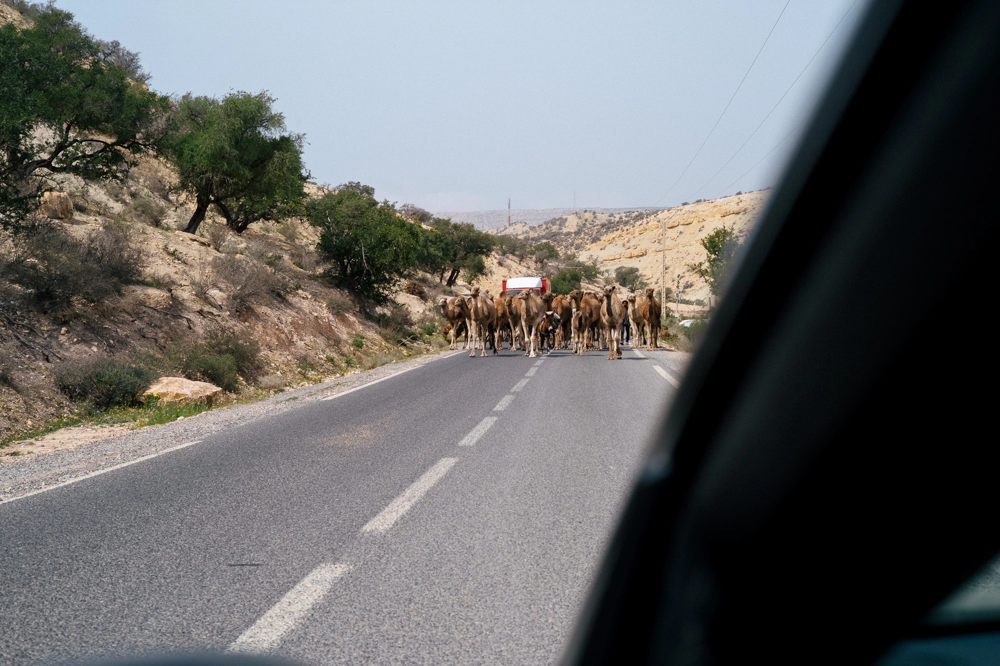
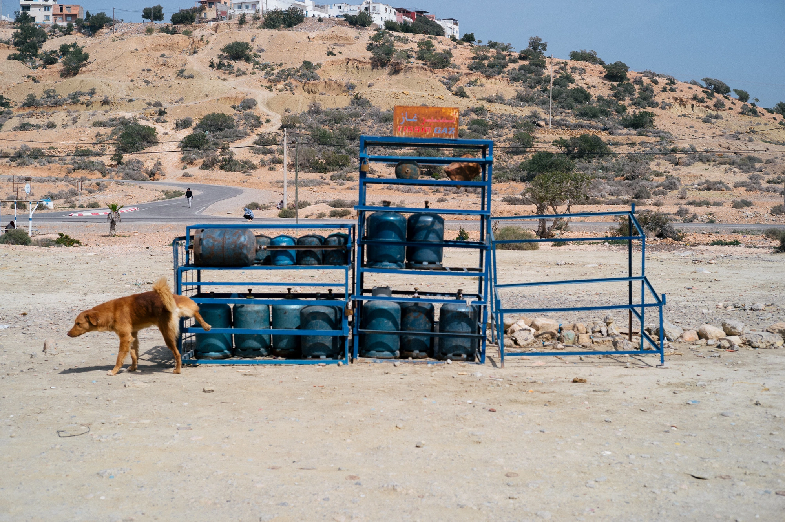

Fin février, on a fui les mois noirs pour un peu de soleil. On a fait un mélange d'Imsouane et Tamraght. On avait déjà un peu visité Tamraght. Mais y être motorisé était une autre expérience.

Pour nos premières nuits, on a découvert un endroit fantastique pour dormir. Le [Beldi Berber Camp](https://www.booking.com/hotel/ma/berber-beldi-camp.fr.html) est un superbe petit camp en dehors d’Imsouane. On a adoré les tentes berbères, le calme qu’il y règne et un staff super sympa! On avait quitté un bon coup de vent en Bretagne pour en retrouver un là-bas. Mais avec le soleil et les sourires, c’était plus agréable. Fatima, qui bosse là, me disait préférer la pluie. Je pense que c’est parce qu'elle ne l’a pas connue en Bretagne. Je lui laisse quand même le bénéfice du doute. Sa cuisine était fabuleuse! Et on ne doute pas d’une personne qui fait de si bons petits plats.



C’était notre première fois à Imsouane. Je ne l’ai pas connue avant la destruction d’une partie des bâtiments rasés récemment. Elle avait une drôle de cicatrice à fleur de peau qui nous a peut-être permis de la connaître avec moins de monde. Mais le cortège de tours opérateurs du surf qui déposent les gens à la journée était quand même déroutant et la vague était peuplée. J’ai quand même adoré la surfer. Si tu ne surfes pas, y’a moins de choses à faire de suite. 

Je me rappelle m’être soulevé en entendant parler de cette destruction par le gouvernement Marocain. Là-bas, j’ai pu en parler un peu plus avec des locaux. Il faut vraiment se méfier des nouvelles qui forcent à la réaction émotionnelle. Je vous laisse lire [cette interview](https://climateandboardsports.substack.com/p/no-wanted-to-surf-when-the-bulldozers) d’un local. Comme toujours, rien n’est noir. Rien n’est blanc. Tout est gris. Surtout le ciel Breton. Je me demande quel visage Imsouane aura la prochaine fois que je la croiserai.

On a redécouvert Tamraght. Cette fois, pour plus de deux jours. C’était notre camp de base. On avait un beau Riad avec une petite piscine pour fatiguer les enfants en fin de journée. On a pu rayonner un peu partout autour. Tellement de beaux lieux à découvrir et y vivre de superbes aventures. Je vais vous en raconter une qui mérite particulièrement votre attention et un rien de votre temps. 



Un matin, nous décidons d’aller jusqu'à Paradise Valley. Une vallée avec de magnifiques trous d’eau et une petite oasis qui donne envie de se poser et profiter. C’est aussi une belle petite marche qui se mérite quand le soleil est de la partie. C’est souvent le cas pour le soleil en fait. Je vous laisse voir [les lieux par vous-même](https://www.instagram.com/explore/tags/paradisevalleyagadir/). Ce n’est pas ce qui nous intéresse aujourd’hui. Le plus intéressant, c’est le retour au parking. Je fouille mes poches. Je ne retrouve plus les clés de la voiture. Au contraire de Baffie, elles n’étaient pas dans l’autre poche. 

Je repars donc faire la randonnée en mode accéléré. Je demande à tous les petits restaurateurs si personne n’a vu des clés de voiture. Je questionne aussi certains passants. J’arrive quasi au bout du trajet (qui est un aller-retour). Je croise un couple de français. Ce coup-ci, j’oublie de demander pour les clés. Ils me voient chercher par terre. Finalement, ils me demandent si je cherche quelque chose. “Oui, mes clefs de bagnole.” Je leur répond. Il s’avère que trois quarts d’heure avant, ils les avaient donné à un couple qui remontait vers le parking. Me voilà soulagé, je peux remonter. 

J’étais, je vous l’avoue, un rien extatique à ne pas devoir appeler Hertz. Les restaurateurs partagent mon enthousiasme au retour. Un me dit même qu’il a eu un appel du gardien du parking. Ce dernier a mes clefs. J’arrive cuit au parking, les enfants sourient, Cloé aussi. Un mot écrit dans la poussière du pare-brise arrière nous dit que le gardien a bien les clefs. Quelle aventure. D’ailleurs, si jamais vous connaissez un couple qui était à Agadir qui vous a parlé de cette histoire, envoyez les moi.

Au retour de cette mésaventure, on se retrouve bloqué face à un troupeau de chameaux. *Venez avec vos bosses, tout est chameau pour moi.* J’arrête la voiture et laisse la magie s’opérer. Ils nous passent autour avec leurs bébés, dresseurs et ânes. Un moment magique qui n’aurait pas eu lieu si je n’avais pas perdu ces clés de voiture. Parfois, on dépense une heure pour retrouver ses clés pendant que les enfants jouent à la plaine de jeux. Et au final, tout le monde est gagnant. Sauf les gens pressés peut-être. Le Maroc nous apprend vraiment que ralentir est la clé. 

Je pourrais passer des heures à vous en dire plus sur ce voyage. Parler des autres mésaventures que l'on a eues. Mais en vrai, l'important c'est de comprendre que les mésaventures sont aussi des aventures. On en rit déjà, on les a bien vécues et surtout, ce n'était pas la majeure partie du séjour, en fait. Sur les jours restants, on flânera dans des souks, on mangera de bons petits plats, on profitera de la plage, on admirera une Punto passer une piste de sable. Des tonnes de vieilles Peugeots, de vieux vans et de vieilles 4L peupleront mes photos. On partagera des iced latte. Tom prendra un kids latte. On s'est laissé porter par le soleil, on a pris notre temps pour s'imprégner de la façon de vivre locale. Je ne peux que conseiller le Maroc aux familles. Les gens sont tellement accueillants et bienveillants. On est rentré depuis une semaine et Louise demande encore si ce qu'elle entend c'est l'appel à la prière. Ce pays l'a marquée. Et nous aussi. 

Vous pouvez aussi en apprendre plus sur les cafés que l'on a visités dans le [bonjour 51](/bonjour/51).