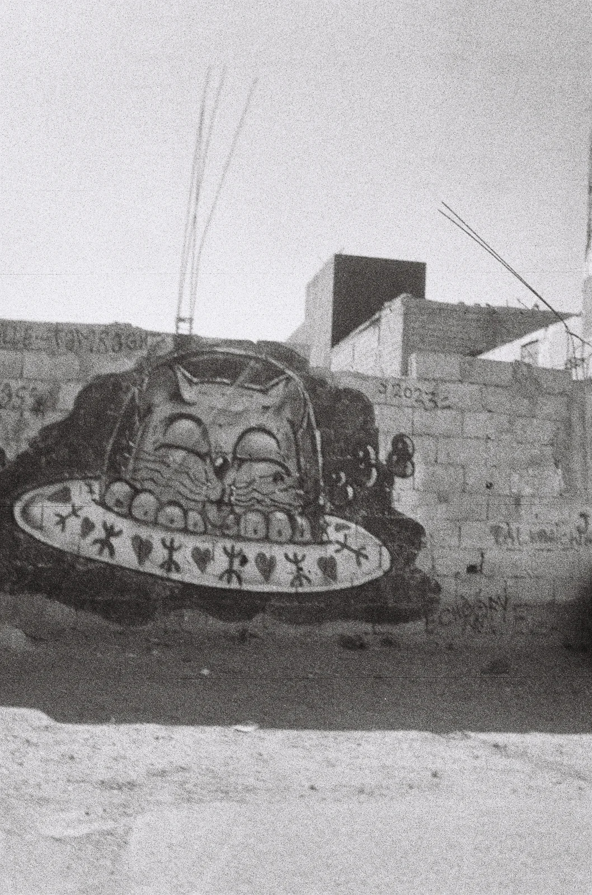
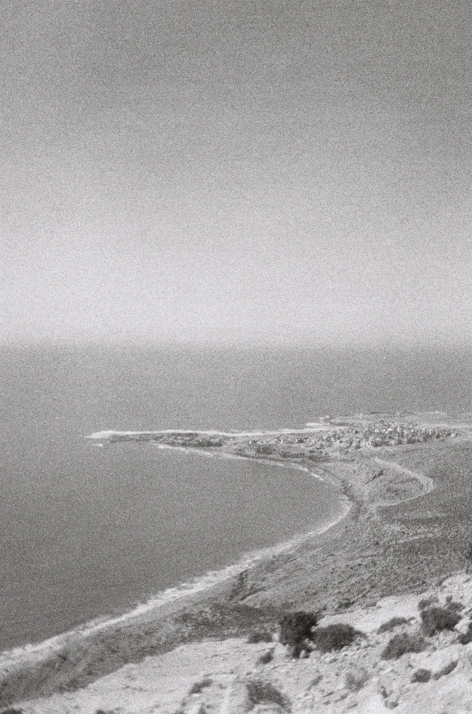
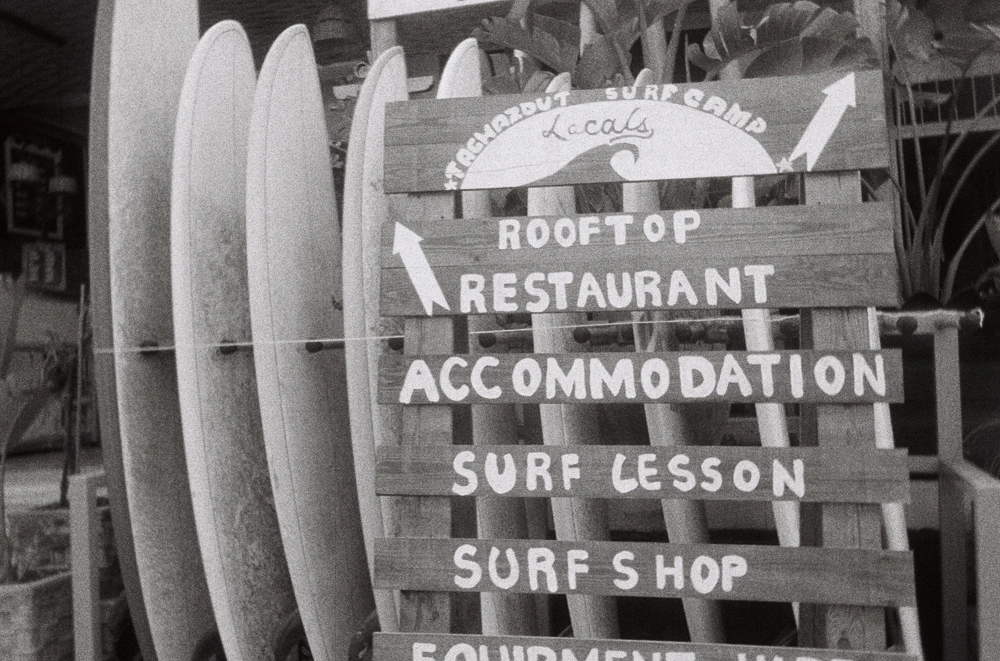
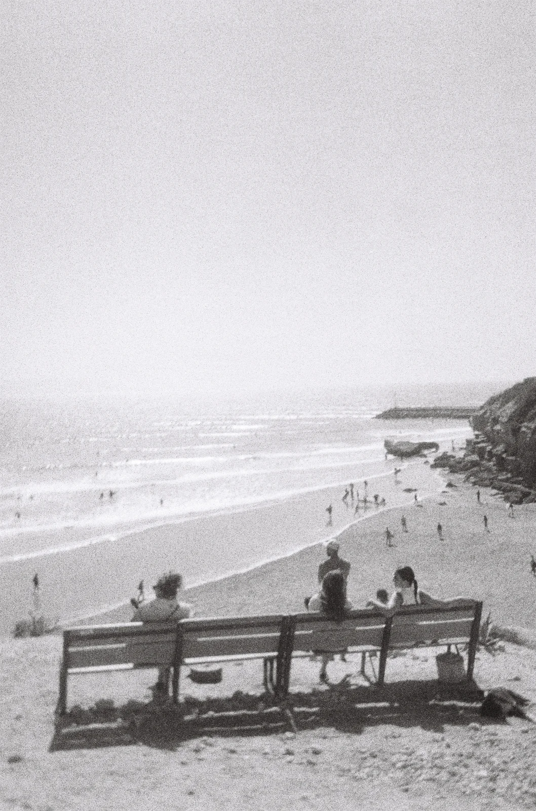
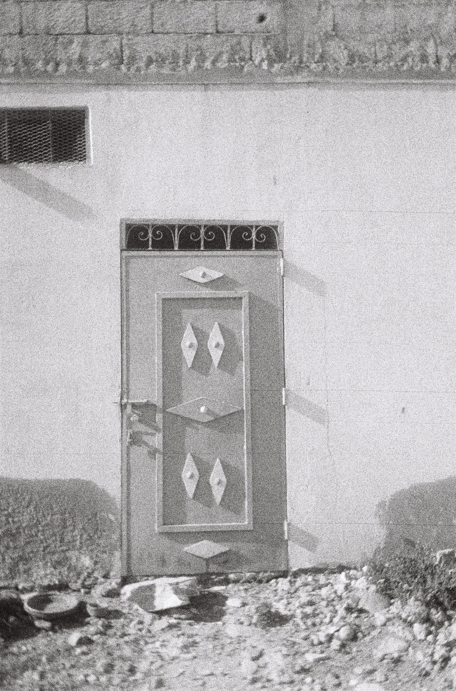
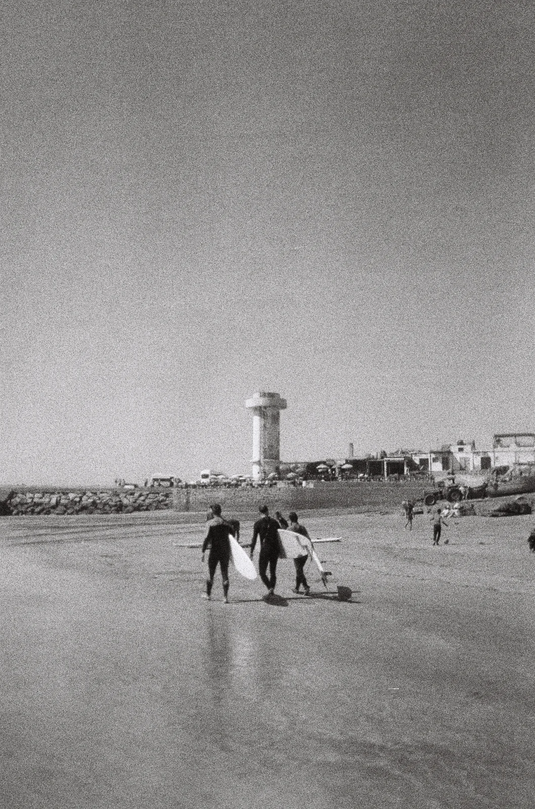
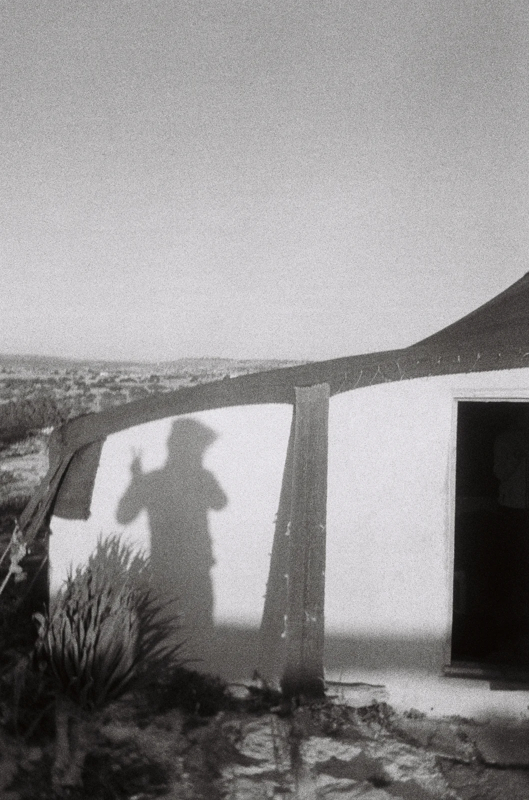
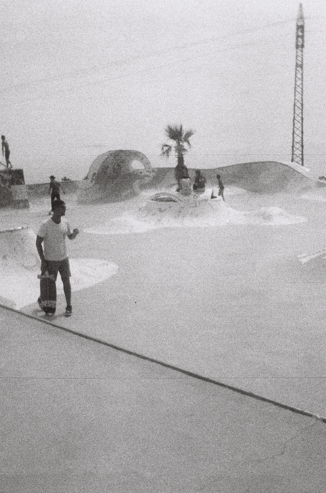
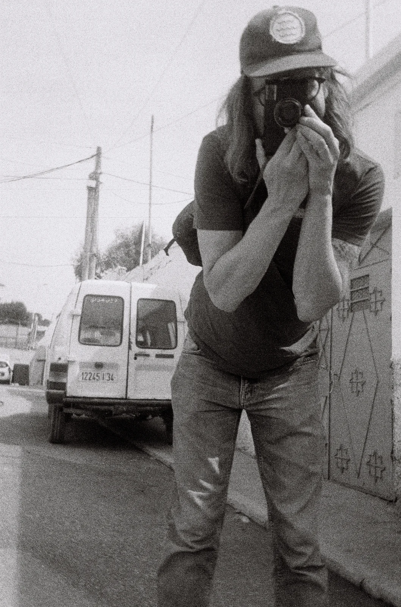
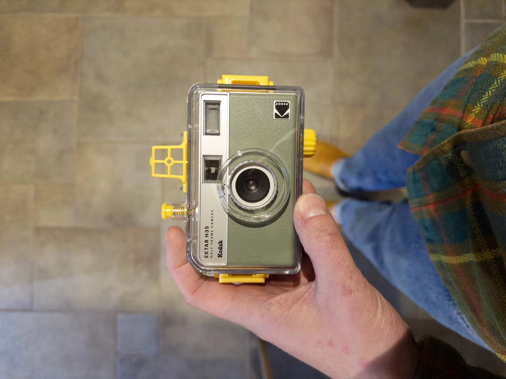

**First published on [Substack](https://bonjouryannick.substack.com/p/morocco-with-a-half-frame-plastic)**

I could have the best camera in the world, I would still be amazed by the fun stuff you can make with cheap plastic cameras. Kodak got back into the film cameras game with a silly little plastic half frame camera.

It became one of my funniest quick point and shoot camera I use. I love how easy and fun it is to shoot diptychs with it. It is small, fits in the pocket and you can just bring it everywhere you want. I even just give it to the kids to have fun and snap stuff they see. 72 shots per roll, that gives you plenty of fun!

I even got a small waterproof housing for it. Cannot wait to bring it to the surf with me and capture fun moments in the water.

So without further ado, here is a set of pictures from Morocco last year.

_This post is the starting point of more posts full of pictures, I love how it looks on Substack_

_Graffiti in Tamraght_

_The magical bay_

_Surf shops everywhere_

_People watching people surf_

_I love to capture their doors_

_Surfers in Imsouane_

_Berber tents in the desert. It was a fun experience_

_Taghazout skatepark is a chill place to snap some pictures_

_Portrait of me by Louise_

_Look how cute it looks in a waterproof case._

If you want to support me, either buy a subscription here, I would happily send you things. Or just get to my webshop and get a print!
