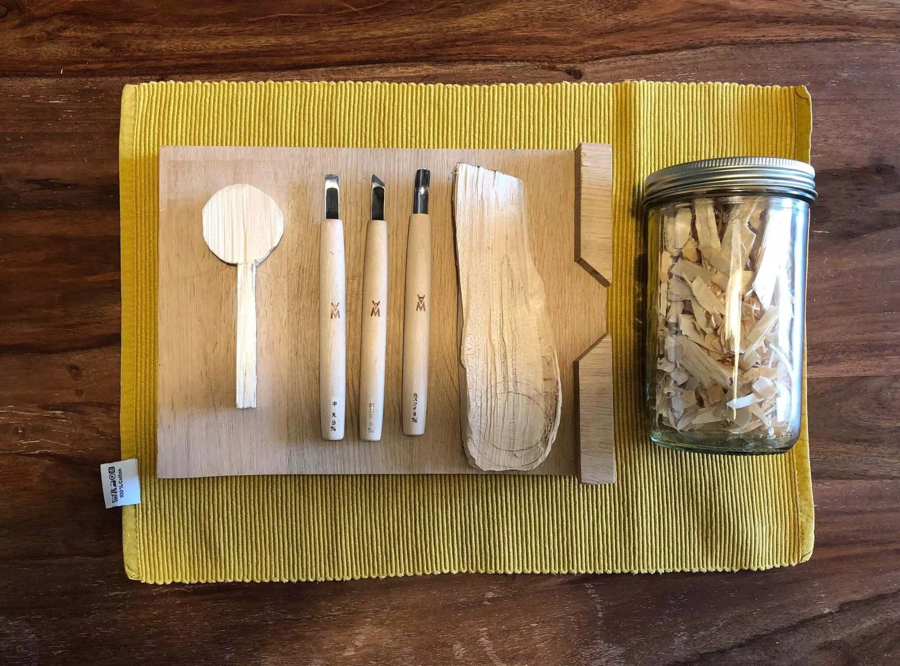

Depuis quelques années, j’ai décidé d’investir en moi-même. Avant, toutes mes passions étaient liées à mon métier. Tout l'apprentissage aussi. Il me faut apprendre constamment. La technologie d'une part et les « soft skills » qui traitent plus des relations humaines que de la technique d'autre part. J’ai donc appris à mieux communiquer, mieux comprendre les personnes et mieux gérer le stress. C’est effectivement utile au quotidien.

J'étais lassé de n’apprendre que pour mon gagne pain. Il me manquait quelque chose. J'ai alors commencé à m'intéresser à mon moi. Minimalisme, pleine conscience et écologie. Ces sujets me suivent encore aujourd’hui et me définissent principalement. Tout cela ne se faisait que dans ma tête. J’ai toujours été plus intellectuel que manuel. C’est un fait... Mon père serait fier de savoir que je sais me servir de mes deux mains maintenant. Que dirait-il de savoir que je pense à investir dans une scie circulaire...

J’ai toujours été attiré par la photographie, je suis passé d’un reflex à la [lomography](https://lomography.com), développé du noir et blanc à la maison, puis le boulot a pris le dessus. J’y suis revenu en arrivant chez [Heroku](https://heroku.com), mon employeur. Des collègues avaient ce magnifique objet qu’est le Fuji X100. Il n’a pas fallu longtemps pour que je m’y remette.

Avec le temps et les vadrouilles, l'appareil était toujours avec moi. Je prenais de plus en plus de photos. J’avais envie de devenir meilleur. J’ai donc commencé des formations en ligne. J’ai commencé par un cours reprenant toutes les bases sur [Udemy](https://www.udemy.com/photography-masterclass-complete-guide-to-photography/). Un bon rappel pour certains cours et des passages qui renforcent les bases ou amènent de nouvelles connaissances.



Ce n'était pas assez. Il manquait quelque chose dans cette théorie. J’aime beaucoup les gens passionnés. J’adore apprendre de gens qui exaltent leur passion. Qui sont comme possédés par celle-ci. J’ai découvert le boulot de [Alex Strohl](https://www.alexstrohl.com). Il avait sorti un [premier workshop](https://workshop.alexstrohl.com), une vraie révélation! Il transmet sa passion de la photo d’aventure et retranscrit cela d’une manière qui me parle. Il n’a pas fallu longtemps avant qu’il ne sorte un [second en été](https://summer.alexstrohl.com).

Il a décidé de faire une série de workshops avec d’autres photographes. Son premier était avec un photographe que j’admire, [Finn Beales](https://www.madebyfinn.com) ([Le workshop](https://finnxstrohl.com). Son travail tant professionnel que personnel m’a toujours inspiré. Raconter une histoire. Raconter sa vie en images. Raconter mon histoire. Raconter ma vie en images. J'attend avec impatience les suivants.

Et c’est ainsi que ce week-end, je me retrouverai à un [workshop en canoë](https://workshops.captainyvon.fr/workshops/workshop-photo-aventure-canoe-et-bivouac-sur-la-loire/). Une microaventure organisée par les amis de [Captain Yvon](https://captainyvon.fr). Rencontrer des gens qui partagent cette envie de partager. J’ai tellement hâte de continuer d'apprendre. Si en plus, je peux vivre quelques aventures par ci par là, c'est encore mieux. Je me réjouis de m’endormir dans ce tipi. Mais me réjouis encore plus de pouvoir le raconter. Vivre pour partager.

D’ailleurs, rappelez moi de vous parler de pourquoi j'ai de plus en plus de coupures sur les mains. Mais ca sera pour plus tard.

