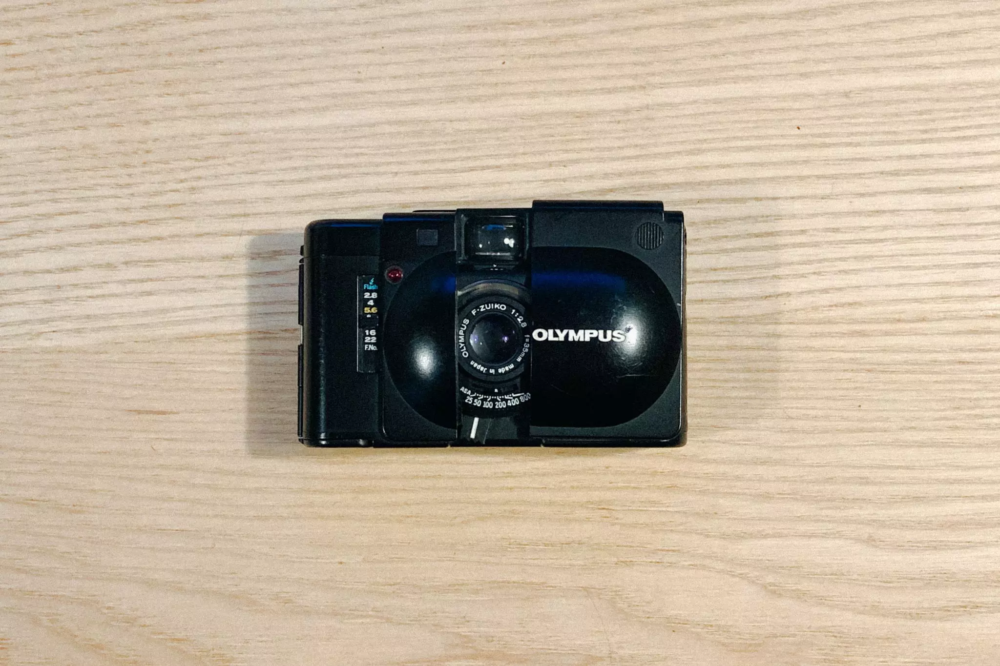
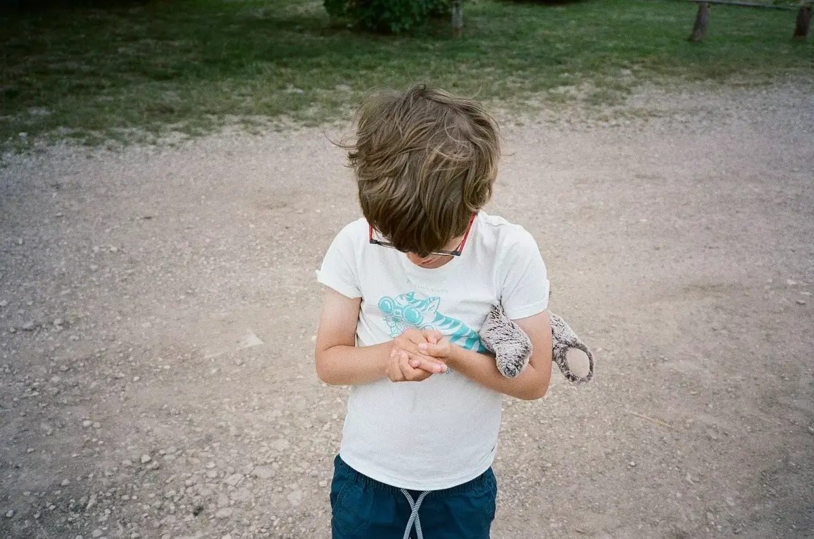
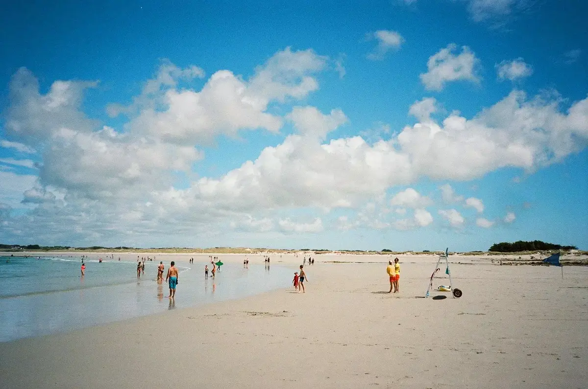
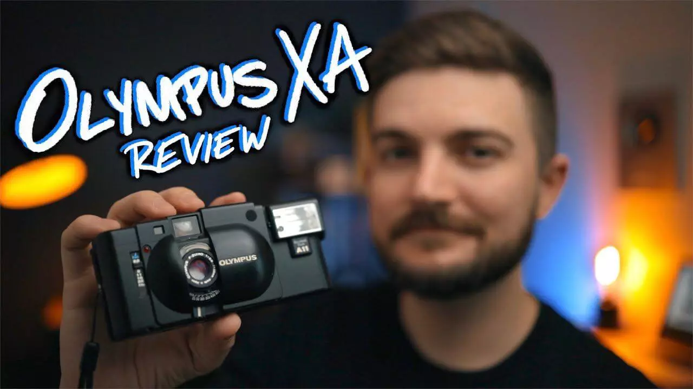
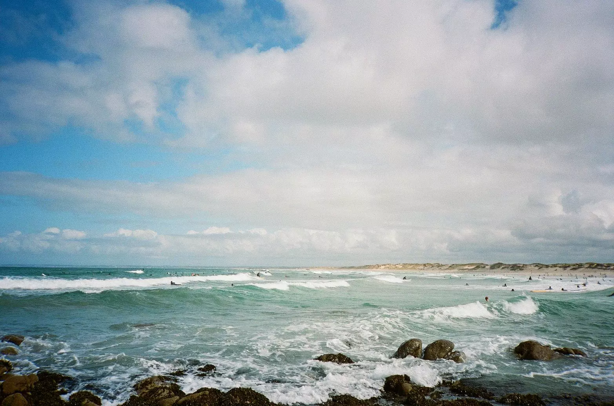

Nous sommes en 2020, Macron compare les gens qui ne veulent pas de la 5G aux Amishs et moi, c'est fait, j'ai revendu tout mon matos numérique. Quel lien entre moi et les Amishs? Aucune idée mais ça faisait une intro un rien connectée à une actualité déconnectée. C'est une année assez étrange. Mais c'est l'année où j'ai décider d'abandonner mon matos photo numérique.

Depuis quelques mois, ce petit Olympus XA m'accompagne quasi partout. Il a vu passer les films cet été et tient bien dans ma poche. C'est un mini rangefinder et non un point and shoot comme sa taille pourrait vous le faire croire. Il est polyvalent avec son ouverture à 2.8 sur son 35mm. Il est mignon et plus petit que mon iPhone. Il ne demande que deux piles et les consomme lentement. Il date de la fin des années 70 mais ne fait pas son âge. En gros, ce petit appareil avec priorité à tout pour plaire.

Un de ses seuls points négatifs à mon goût, c'est le déclencheur qui me fait penser au touchpad d'un macbook à plat. Pas de bruit, pas de détente. Il faut écouter le bruit qui est plutôt léger lui aussi. Mais on s'y habitue vite quand même. J'ai eu du mal à le trouver aussi au début.

Attention, si celui-ci vous intéresse, Olympus en a sorti quelques uns dont le nom porte à confusion. Du XA au XA4... en passant par le XA1. Vous auriez pu commencer par le XA0 mes amis. Ils ont tous d'autres qualités mais j'apprécie le côté rustique du XA*0*. Dans sa simplicité, il a un petit côté quasi indestructible. Il est tombé plusieurs fois et un ressort a fini par sauter. Parfois, la cellule se referme avant que je ne fasse la photo et je dois refermer et réouvrir complètement pour fixer le tout. Encore heureux, c'est simple. Je me dis que le démonter et remonter ne dois pas être trop compliqué. Je n'aurais jamais osé avec un numérique.

Je ne suis pas le seul à apprécier cet appareil, [Matt Day](https://www.mattdayphoto.com) a une super review sur youtube de l'appareil que je vous conseille. Il a sur son instagram pas mal de photos au XA aussi, mais bon faut chercher, il mixe de tout. Vous pouvez toujours regarder [#olympusxa](https://www.instagram.com/explore/tags/olympusxa/). Si vous voulez un review un rien plus technique, allez chez [Ken Rockwell](https://www.kenrockwell.com/olympus/xa.htm). Ou un plus bel exemple sur le terrain à la réunion chez [carnets de traverse](https://www.carnets-de-traverse.com/blog/photos-de-voyage-olympus-xa-la-reunion).

C'est à mes yeux un super compagnon de voyages mais aussi de la vie de tous les jours. Parfait appareil pour documenter sa vie et nos petits moments, j'en suis pleinement satisfait. Il se fait oublier tant dans la poche que lors de la prise de vue. Ce petit format est un véritable atout pour le peut de place qu'il prend dans mon sac à dos de voyage. Parfait si vous voulez garder la main sur les réglages mais avoir la taille d'un point and shoot. Mon premier coup de coeur photo de l'année. J'en ai eu d'autres dont je vous parlerai plus tard.

Et vous, c'est quoi votre petit coup de coeur photo de l'année? Quel est votre appareil de tous les jours? [Racontez moi tout sur Twitter](https://twitter.com/bonjouryannick).
