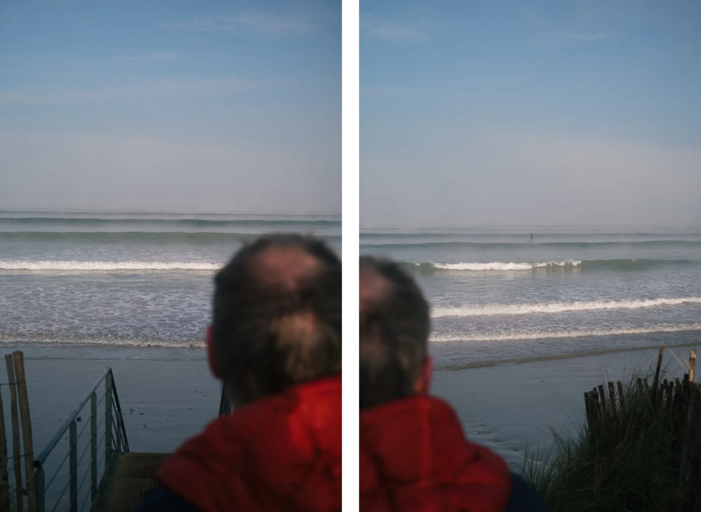
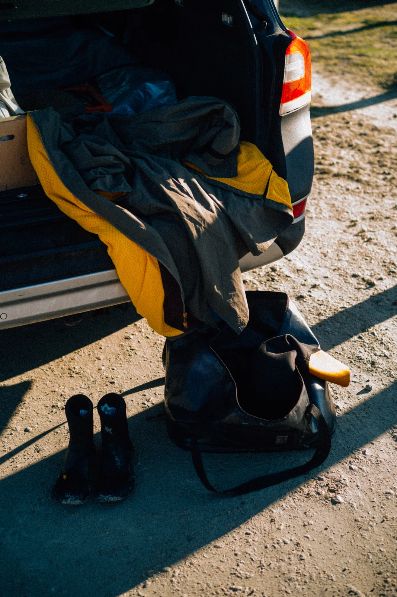

**First published on [Substack](https://bonjouryannick.substack.com/p/on-bringing-the-camera)**

You get a surf, you snapshot something and have to share it. Otherwise, did it happen? It is in surf, but more broadly across every experience you can get. If you don't document it, was it real? I am one of those kinds for most situations, I must admit. When it comes to surfing, I get to the parking lot, go check the waves, chat a bit if people are around, suit up, wax up and go.

_Kodak Ektar H35 with the waterproof housing_

While I want to document my surf more, I went too far the last time. I brought my Kodak Ektar H35 and its waterproof case with me. I wanted to document it. I was in the water with it. And it ruined the day. I had another thing to focus on while doing that thing I am fully focused on. Surfing monopolizes my brain. Adding that extra movement to think about every time I was paddling in or taking off made the experience less immersive. I had to make sure the camera wasn't hitting the board. I had to care about trying to frame stuff after passing the bar. I had to... This was controlling my experience. Maybe I will have good pictures of that day to remember. But I will remember the fact that I had to. It was too much for this time.

Next time, I won't grab a camera while surfing. Do one thing and do it well. I really want to get back to water photography. But not this way. I need to come back more often and have part of the session dedicated to the camera. Not mixing things up. My beloved Nikonos (III and IV) are getting some well-needed service love right now. It is gonna be the reason to get back to the water without a board.

I will still grab a parking lot moment and document it because it is part of a culture I enjoy documenting. Documenting the impatience to get in the water and the joy of having been in it.

