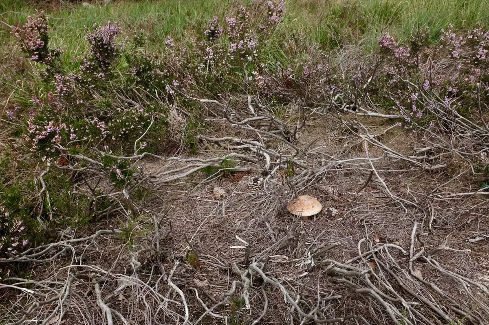
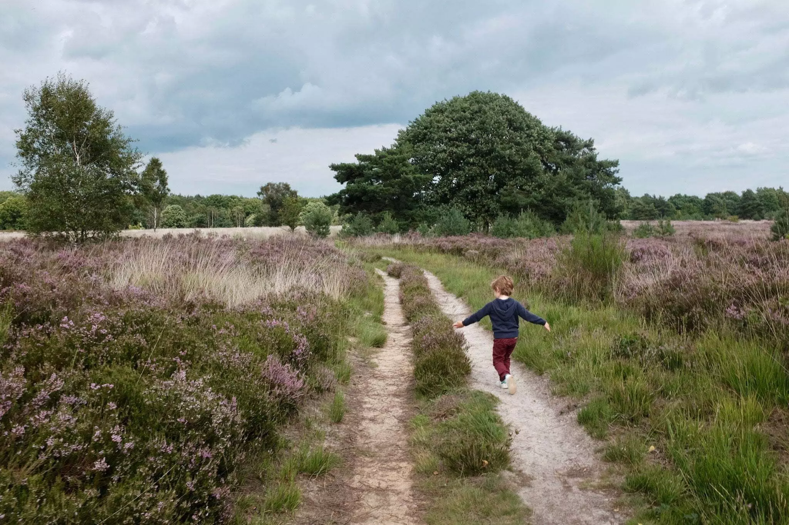
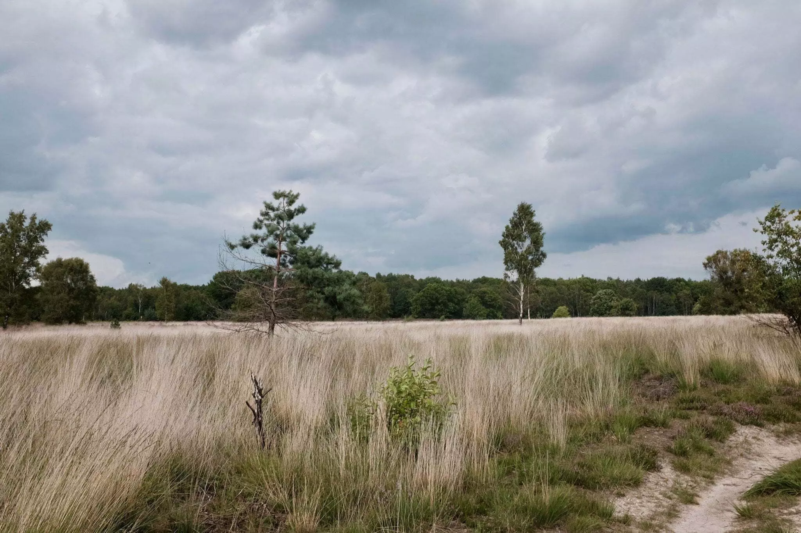
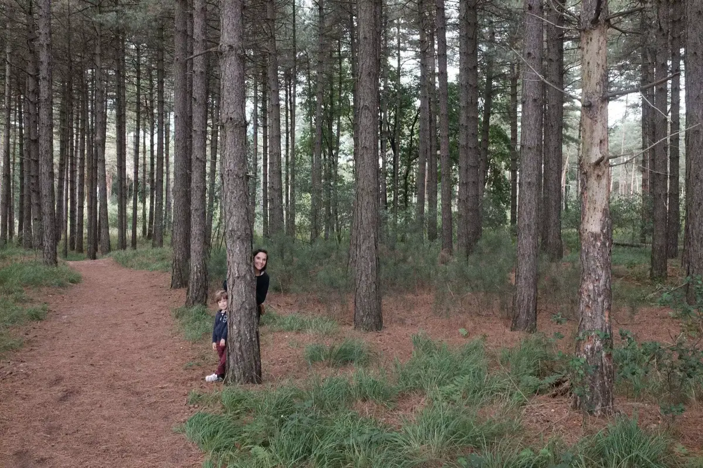

Nous entendons toujours parler des parcs nationaux Américains. J’étais loin de me douter que mon plat pays accueillait lui aussi un parc avec ses rangers. Il se situe dans la province du Limbourg, du côté flamand. Le parc national de la Haute Campine s’étend sur plus de 5700 ha de forêts et de bruyères. Il est accessible via 5 portes, nous décidons de nous rendre à celle de “Mechelse Heide”. Cette porte est proche de Maasmechelen plus connu pour son shopping que pour son entrée dans le parc national.



Nous nous lançons dans une des balades qui passe d’un paysage de bruyères à une forêt avec au passage de belles vues panoramiques sur le parc. Tout un programme pour cette balade de 5.5km.



Nous commençons sur un sol sablonneux mais grimpons vite vers les bois. Avant d’y pénétrer, une vue sur une ancienne carrière et un beau petit lac. L’entrée dans les bois me fait penser aux Ardennes mais rapidement nous passons à un paysage plus proche de nos dunes.

Fait étrange, des milliers de petites bêtes volantes sur les chemins de sable, on avance au milieu de celles-ci. Elles volent à une dizaine de centimètres du sol. Si vous savez ce que c’est n’hésitez pas à me le dire. Cela amusera Tom qui court au milieu, ça en devient un jeu.

On arrive dans un paysage plus proche de nos Fagnes avec une importante couche de bruyères. Elle est violette et en fleur à notre passage. Cela fait un magnifique tapis violet.On replonge dans la forêt et finit la balade en longeant la route mais heureusement en n’étant pas trop proche de celle-ci.



C’est un parc vraiment surprenant. Un condensé de Belgique dans le Limbourg. Environ 300km de randonnées et de multiples parcours nous permettrons sans nul doute de revenir y passer une journée et pique niquer sur le trajet.

### INFORMATION

*Suivez les hexagones jaunes pour cette balade.*

Durée: 2h

Distance: 5,5km environ

<iframe data-card-recommend="0" data-card-recommend="0" data-card-recommend="0" data-card-recommend="0" src="https://www.google.com/maps/d/embed?mid=1Jh5CVwqkCL68cd3Lkq0LlchGctKswAuD&hl=fr" width="100%" height="480"></iframe>

