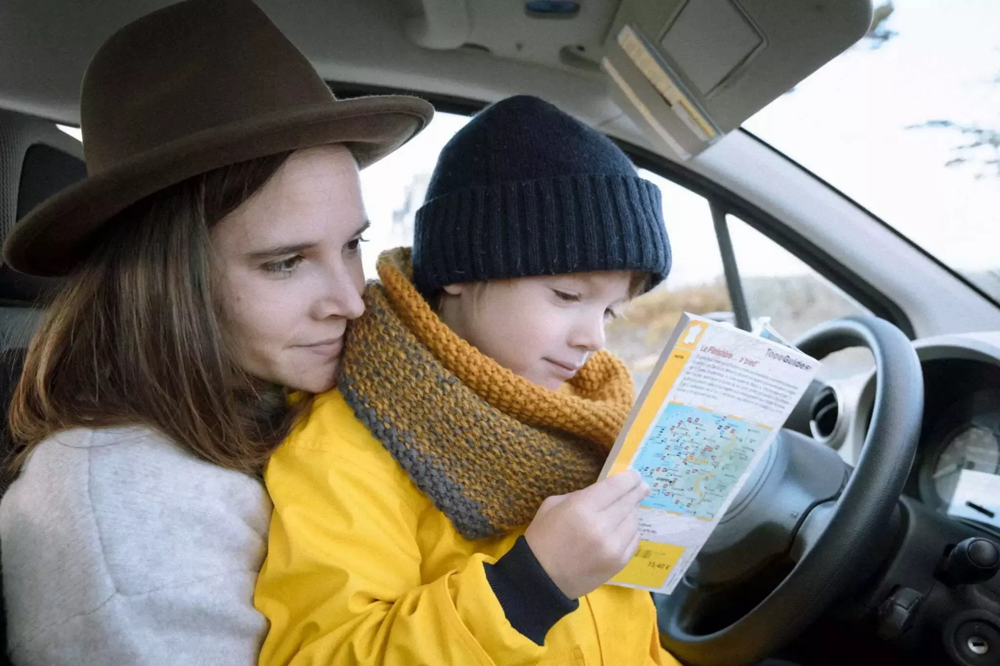
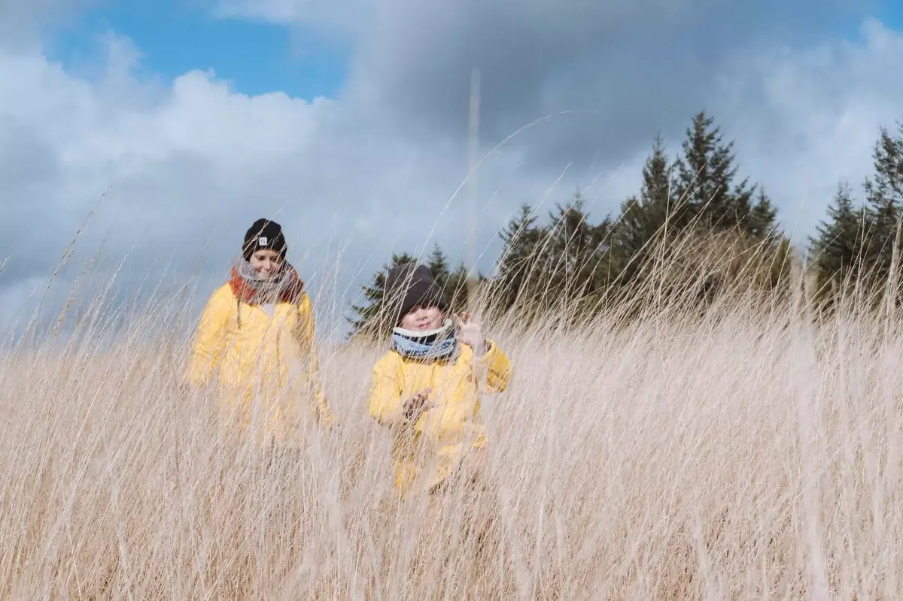
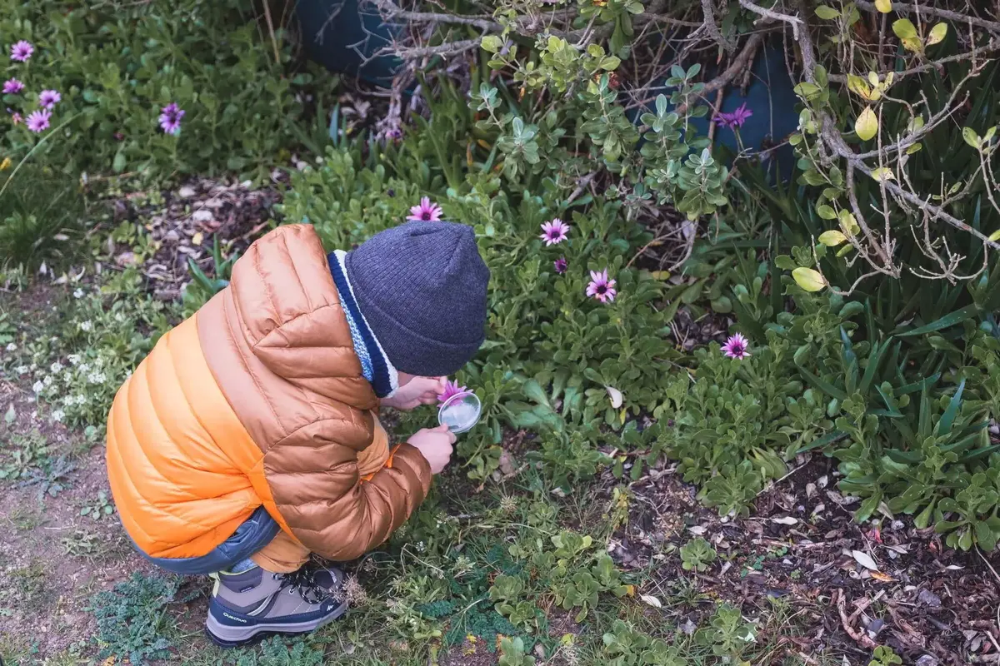
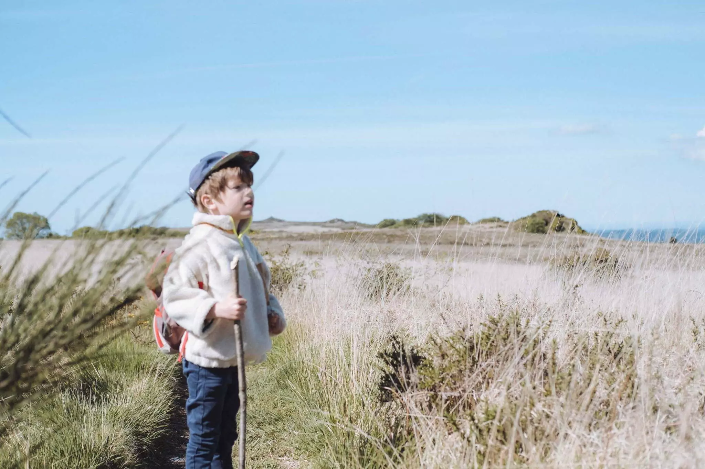

Cela fait maintenant 5 ans que l'on se balade dans la nature avec notre petit bout. Peu importe la saison, on aime sortir et prendre l'air. Ce n'est pas toujours facile et motiver un petit garçon de 5 ans, cela peut être une aventure en soi. Je me suis dit qu'avec la sortie de la [newsletter des marmots](https://www.lesothers.com/marmots), il était temps de vous donner mes petites astuces et conseils pour des vadrouilles pleines de plaisir avec vos chérubins.

## Avant le départ

Préparez vous à chausser vos bottillons et partons à l'aventure.

Avant de partir, il sera important de bien préparer son sac. Des friandises et snacks seront nécessaires. Une petite fringale peut vous gâcher votre moment nature. Tant pour vous que pour eux. N'hésitez donc pas à en prendre trop. Cela se gardera sans nul doute.

Remplissez quelques [gourdes](https://amzn.to/2XmnBwF), les enfants aiment, en général, [avoir la leur](https://amzn.to/2xtaZsT).

Vos enfants pourraient apprécier aussi de préparer leur propre sac. Laissez les choisir des objets, jouets qu'ils veulent emporter. Nous avons un [petit kit d'explorateur](https://amzn.to/2XrsHMN) que Tom aime prendre avec lui. Il a aussi [un livre rempli de traces d'animaux](https://amzn.to/2Xlx7js) qu'il aime emmener.

Partagez le tracé de la balade, personnellement, j'adore lui montrer ce que l'on va faire, la longueur et les différents points d'interêt que nous croiserons. Cela lui permet de se faire une idée de ce qui va se passer et lui permettre de se réjouir à l'avance. Ici, on utilise [Gaia](https://www.gaiagps.com) pour tracer les vadrouilles. Je pourrais vous faire une belle liste des sources pour nos sorties. Cela sera sûrement un prochain article.

Un dernier point important, prenez des chaussures adaptées. Une bonne paire peut faire votre vadrouille comme une mauvaise peut la tuer. Pas besoin de surinvestir, une bonne [petite paire de chez decathlon](https://www.decathlon.fr/ch-mh500-mid-wtp-jr-marron-id_8343067.html) fera l'affaire.

## En route les marmots

Durant la balade, n'hésitez pas à faire pas mal de pauses. Leurs petites jambes travaillent plus que les vôtres. Cela permet de sortir les snacks, les gourdes et de vider les vessies. S'il fait chaud, une pause à l'ombre permet de bien souffler. Ce que vous ressentez est décuplé chez eux. N'hésitez pas non plus de sortir des sentiers battus, l'aventure sera encore plus forte pour eux.

Privilégiez des balades courtes au début. Ne le faites pas pour manger le plus de kilomètres. Profitez en pour ralentir, observer, partager et apprendre. Un des autres points super important pour nous, les faire jouer un maximum durant la balade. Des jeux classiques d'observation permettent de distraire leur esprit qui doit tout le temps être en ébullition.
Dans nos jeux favoris:

- Repérer 5 sortes d'oiseaux
- Ramasser des cailloux aux formes étranges
- Trouver des choses d'une couleur choisie
- Entendre 3 sortes de cris d'oiseaux
- Trouver un baton de marche
- Trouver la feuille de l'arbre annoncé

Aussi, depuis quelques temps, nous avons commencé à chercher des géocaches avec Tom. Installer l'application de [geocaching](https://www.geocaching.com/play), trouvez des lieux proches de chez vous et incorporez les dans vos marches. Mieux encore, certains font des caches sur une boucle de randonnée. Cela permet de passer de cache en cache et de ne pas voir les kilomètres passer. Je pense que plus jeune, cela n'aurait pas marché. Maintenant, la chasse au trésor est vraiment un must! Elle nous permet d'augmenter les distances sans le remarquer.

Pour les longueurs de marches, beaucoup parlent de 1km par année de l'enfant. On a commencé comme cela et maintenant, il adore quand on marche "plus que son âge". C'est comme un challenge pour lui, son petit trophée de vadrouille. Preparez-vous à répondre à "C'était une balade de quel âge ?"

Pour les plus jeunes, vous pouvez vous limiter à des tours poussettes friendly. Personnellement, depuis ses 2 ans et demi, on a abandonné la poussette et on le portait quand ça n'allait plus. On le fait toujours. Les épaules permettent de rendre la balade différente. Apprêtez vous à servir de monture. Pour les plus petits, on pensera à avoir un [sac de portage de dos](https://amzn.to/2XtXXWU).

Le but est toujours de s'amuser et de prendre l'air. Trouvez un équilibre et profitez. Découvrez ensemble. Observez la nature et vos marmots. On a toujours quelque chose à apprendre de eux.


