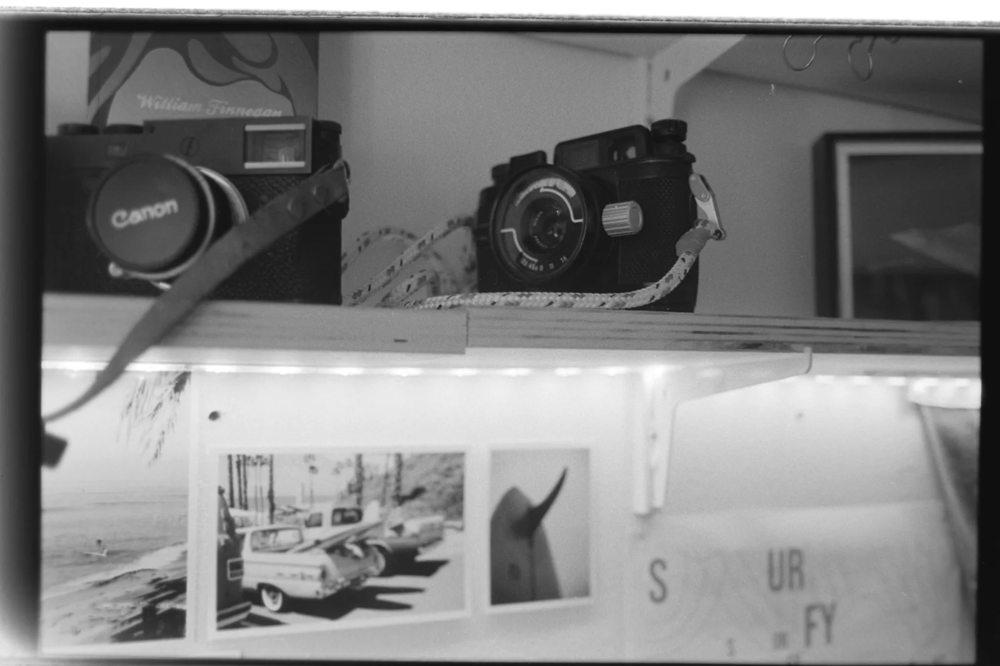
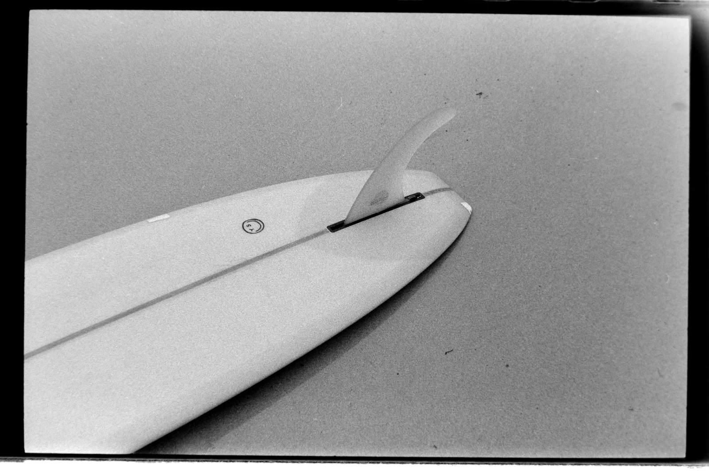

**First published on [Substack](https://bonjouryannick.substack.com/p/refueled-surf-club-interview)**

A few moons ago, I found this in my Instagram DMs:

> Hey I’m starting the Refueled Surf Club series back up. Would you like to be included?
> 
> Let me know if interested.

I got overly excited. Refueled made [a magazine on Ryan Tatar](https://www.blurb.com/b/9616846-refueled-one-series-ryan-tatar), one of my all-time favorite surf photographers.

And the new Surf Club series already had some amazing guests: Chris Gentile, Jacob Ellis, Corina Rose and Anna Gudauskas, to name a few.

Chris Brown, who runs Refueled, and I have been talking ever since. I had a serious case of imposter syndrome, and he made me understand I belonged here.

Thanks a lot, Chris.



### What is it about film, and how do you feel it shapes your narrative?

I love the whole ceremony of film. I love that even when you try to master everything, you still get surprises. It forces you to slow down. It forces you to notice. Then you have to wait and learn patience. It is the filter coffee of photography. To me, art is at its best when you have constraints. A prime lens, a roll of 36 exposures, manual focus. All of that makes you think more than a Swiss Army knife that does it all. Or to sum it up: I find it more fun.

### Explain Glaz to us.

Glaz is a color that doesn’t exist in English. It’s the color of the ocean, or the sky. Glaz is teal if you lack imagination. It’s an old Breton word, and I love that Breton is still alive here. The word means much more than a color. It’s a feeling, the way the ocean makes me feel. I fell in love with glaz when I arrived in Bretagne. I eventually got it tattooed, with a sentence you could translate as ‘the glaz in your eyes.’ It’s also the name I give to all my Nikonos work and water photos. Even if I’m not as productive as I’d like.

### Describe the longboard you had shaped by Mimosa.

It’s a classic old-school log reinterpreted by Mimosa, a 9’6. The first board shaped for me. I’m still a kook, but a kook with a damn good-looking board. I started surfing a few years after arriving in Bretagne, later in life than most. I picked a different color so my wife could spot me from the beach. I just love that peach vibe. It’s my everyday board. If I can’t surf it, it means the swell is too big for me. And if it’s too small, I’ve got an 11’ glider from Plume d’avion, and boy does that thing fly.

Originally published by Refueled on Instagram:

If you are interested, you can find the other interviews on [Refueled Magazine Instagram account](https://www.instagram.com/refueled.magazine/).
