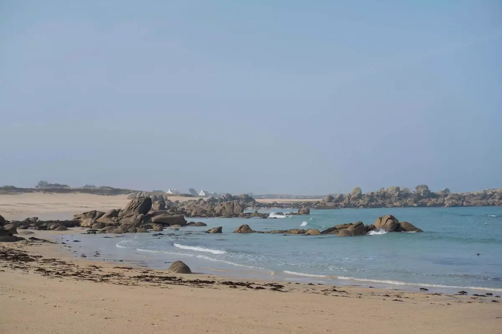
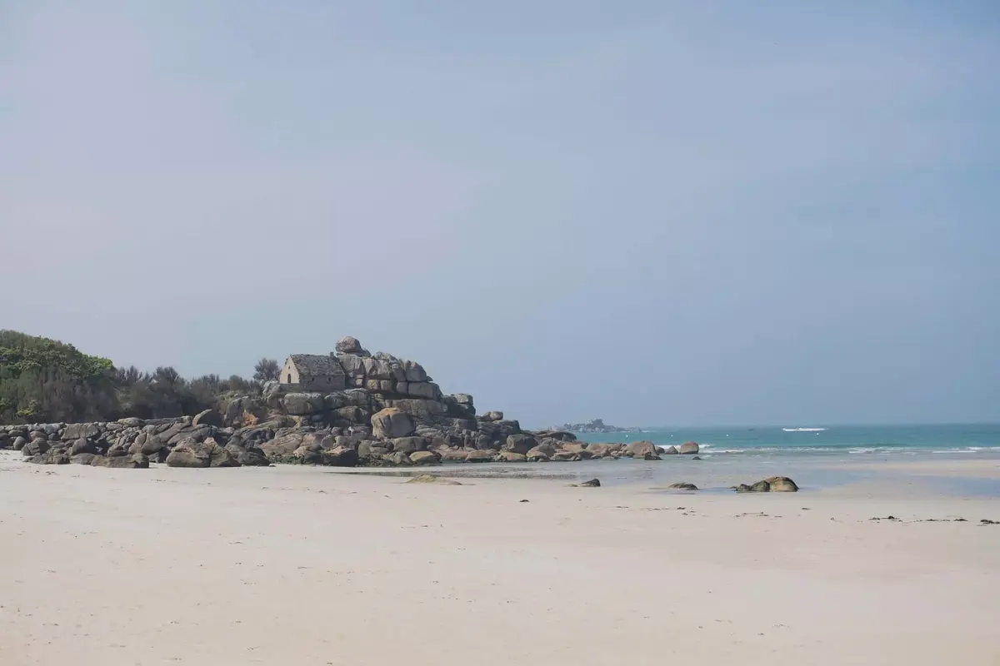

Cela faisait un moment qu'on en parlait. Avec Cloé, on rêve de vanlife avec un grand V. Pour mes 35 ans, Elle m'offre une virée en Volkswagen California. Un très bon moyen de tester sans trop se mouiller me direz-vous.



## Vendredi

On part chercher Tom à la sortie de l'école. On a chargé notre voiture avec les affaires du week-end. On décolle pour Morlaix. On arrive au garage Volkswagen. La personne de [Black sheep van](https://www.blacksheep-van.com) nous y attend, il nous explique la totale. Je vois la tête de Cloé changer quand il annonce que c'est une automatique. Je n'ai toujours pas de permis et j'ai confiance en elle. Cela ne me fait ni chaud ni froid. Elle s'en accommodera bien vite d'ailleurs.



Une fois le van chargé, on se met en route vers le Saint-Graal du vanlifer. Un spot parfait en bord de plage tranquille et au calme. Un lieu parfait où savourer la vie et profiter de cette première soirée. On est dans le coin de Saint-Pabu. Lieu découvert via un mix de [park4night](https://www.park4night.com) et de conseils de [Grégory](https://gregorymignard.com)



Pas de chance, le spot a déjà un gargantuesque camping-car qui prend une place. Il nous reste deux places. Ouf. On ne sera pas seul, cela rassure quand même pour la première nuit. On arrive à temps pour l'heure dorée. La plage se voile d'un ton magnifique doré et rosé. On descend sur la plage et on se laisse vivre.

On découvre la cuisine dans le van, on monte le poptop et on se met à l'aise. Le premier repas est un succès. Je sors faire quelques photos de nuit du van. C'est déjà l'heure de se coucher. Tom est surexcité. On dort au dessus tous les deux et Cloé seule en bas. Une première nuit où l'on cherche sa place. Quand on fait quasi 2 mètres, rien n'est simple. 21h30, on est couché et un camping-car arrive et se pose de l'autre côté. Décidément, ce lieu a du succès.





## Samedi

Premier matin, encore des premières fois. Petit déjeuner, café. On part se balader et s'adonner à un de nos nouveaux passe-temps en balade, du [geocaching](https://www.geocaching.com/play). Une activité parfaite pour ceux qui aiment marcher et se balader avec des enfants. La chasse au trésor est finie, on rentre au van.




On sera rejoint par Grégory et sa jolie famille pour un bon petit repas. Première rencontre dans la vraie vie aussi. Rencontrer des gens, c'est top. Surtout quand tu t'es expatrié. Un petit barbecue qui se transforme en cuisson à la poêle. Le vent n'arrête pas de souffler la flamme du barbecue. Tom se pose et écoute des histoires dans le van avec la fille de Grégory et Marion. Encore un avantage du van par rapport à la voiture. Le confort de vivre lentement.

On se quitte et on reprend la route. Tout se range facilement, en même temps, on a voyagé léger. On décide de rouler lentement en direction de Kerlouan. On cherche un deuxième spot de rêve. La fatigue se fait sentir. On finira sur une aire pour camping-car. On n'a pas osé passer sous les barres de 1,90m. Le van est censé passer mais on testera avec le nôtre. Ne pas trouver un deuxième spot de rêve ne nous dérange pas. Cela nous permet de voir que tout n'est pas toujours comme sur instagram pour la #vanlife.



## Dimanche

Kerlouan et ses environs ne nous déçoit pas. On y reviendra. On pose le van sur un parking et on descend sur les plages. On remonte et on va parker le van sur une autre découverte de park4night. on mange face à la mer et on part à l'aventure dans les rochers. Ca escalade et ca évite les petites zones d'eau. On finira les pieds au sec. C'est déjà dimanche. On décide de ne pas rentrer trop tard parce qu'on aime aussi rentrer chez nous après un chouette week-end. On prendra bien sûr la route touristique pour rentrer.

Les leçons de ce week-end, vivre lentement, profiter, improviser et prévoir l'imprévu.

