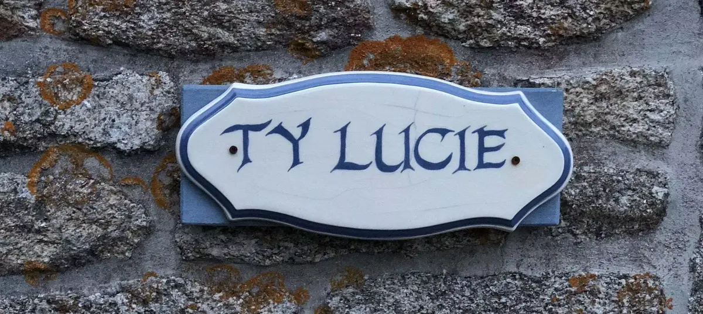

> Berrien, France. Hier, 998 habitants... Aujourd'hui, 1001.

Cela fait déjà une semaine que nous avons pris la route. On signe les papiers de la maison et on démarre cette nouvelle vie. À la moitié de la route, Cloé le sent bien, on le fera d'une traite. La nuit n’était pas tombée. Ils nous avaient laissé un matelas et un lit. Juste ce qu’il nous fallait en attendant les déménageurs qui viendraient deux jours plus tard. Les clés étaient prêtes et nous attendaient.

Une nouvelle aventure. S’inscrire à la mairie. Ah non, c’était juste changer le nom du compteur d’eau. En fait, on s’inscrit nulle part. Enfin si, au consulat pour moi. Prouver qu’on habite ici? Une facture d’électricité à notre nom... facile! Enfin si tu as ton RIB. Le RIB est roi en fait. Ce papier avec un IBAN qui commence par FR. C’est le saint Graal de la France. Ton passe partout.

Enfin sauf si tu ouvres ton compte au bar tabac, ce RIB la n’ouvre pas toutes les portes... on attend toujours pour ouvrir ces portes... mais parfois un IBAN SEPA ça suffit... Merci la simplicité. Mais je m’égare...



Première nuit, mal dormi, petit lit mais pas un bruit... même pas de fond. Réveil avec les oiseaux. Il fait beau.

Il fait souvent beau en fait. Bretagne terre de contes et légendes... une d’entre elles est la pluie. On la voit mais on voit aussi le soleil. Beaucoup mais c’est moins étouffant quand tu peux jouer à cache cache dans ton verger ou ton potager. J’y ai même déjà mis la main dedans. Je connais rien mais j’aide et j’apprends. J’aime et j’apprends.

Le camion de déménagement arrive. On croise notre première autochtone... enfin elle est bruxelloise et vit ici depuis 3 ans. Le camion se vide vite merci les déménageurs.
Deuxième rencontre, notre voisin d’en face. un homme qui nous accueille simplement et sympathiquement.
Troisième rencontre, des amis des anciens propriétaires. Anglais eux aussi. Ils nous amènent des œufs et invitent Tom à venir en chercher quand il le désire.

Je me sens bien. On dirait une petite communauté. C’est chouette. Le hameau est petit, vite fait le tour. On croise petit à petit les gens. Des belles rencontres que j’ai hâte de voir grandir.

_Petit aparté, je viens de tuer deux moustiques. Désolé pour leurs familles._

Jeudi balade en forêt avec un collègue et sa compagne. Barbecue. aussi on prend le modèle d’expo et on le chauffe. Je tombe amoureux de Biocoop.
Vendredi, je racle de la peinture qui a pris l’humidité et m’ouvre sur un clou rouillé. Ça saigne c’est ça le bricolage... oups suis je en ordre de vaccin? Je fouille les caisses et retrouve un papier le lundi... 2009 ouf on est bon. Faudra penser à faire le rappel quand même monsieur.
Samedi arrivée d’une amie de Cloé et de mon frère filleul. Balade de 11kms, on croise des menhirs et des tiques. J’en retire trois. Saloperies.
C’est déjà lundi, on reprend le boulot... pas encore d’internet... on va utiliser le hotspot et écrire un peu aussi pour vous partager tout ça.

On se remet à la course. Les sentiers boueux et les petites routes. Encore un tique. On se pose et on profite. Cette vie commence bien. Hâte de la partager avec vous.

_PS: Je sais que je suis tard pour la première semaine_

**Un petit florilège de ce que j'ai posté en story instagram**








