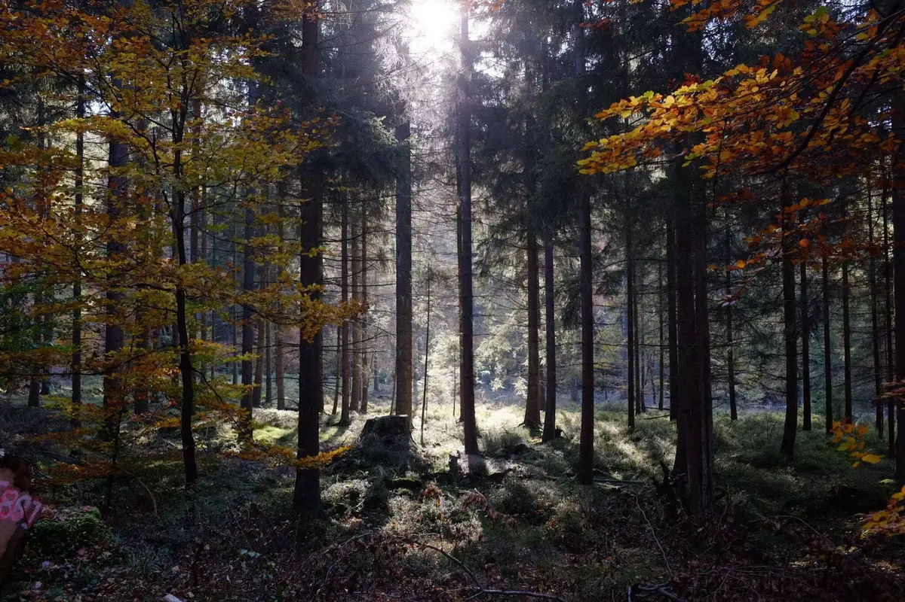
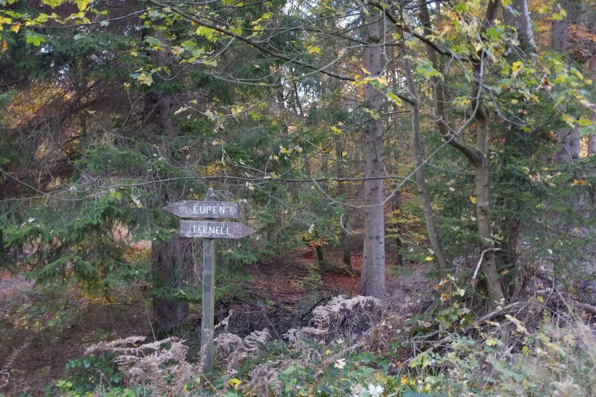

Suite à une invitation de Pascal, nous décidons d'aller nous balader entre amis avec une ribambelle d'enfants à la maison Ternell. Nous avions découvert cet endroit dans une super [liste de balades dans les cantons de l'est](https://www.eastbelgium.com/fr/randonnee/excursions-d-une-journee/balades-de-reve) en Belgique. Nous avions fait une boucle de 8km la dernière fois. Ici étant plus nombreux, nous avons préféré faire la boucle de 4km.

La balade commence le long d'un chemin forestier et une fois arrivé au niveau d'une cabane, nous la longeons et descendons en suivant un cours d'eau. Cette partie est définitivement déconseillée aux poussettes. On passe sur de petits ponts et de grosses racines. C'est vraiment un chouette début de parcours.

Après un moment, la signalisation que nous suivions (croix jaunes) vient à manquer. Nous décidons de faire une pause et de prendre le goûter au bord du cours d'eau. Nous remarquons qu'il manque un panneau, les indications devaient être là. On croise des gens faisant la même boucle en sens inverse et grâce à eux nous savons vers où nous diriger. Après une bonne pause, nous reprenons notre route. On rejoint le chemin forestier du début qui fait une longue boucle et nous ramène à la maison Ternell en remontant calmement ce que nous avons descendu.



C'était une belle journée d'un été indien très tardif. On s'assied en terrasse et profite d'une spécialité locale, une bière aromatisée au gingembre très agréable à déguster avec ce petit soleil de fin de journée.

### INFORMATION

Durée: 2h avec une belle pause

Distance: 4km environ

<iframe data-card-recommend="0" data-card-recommend="0" data-card-recommend="0" data-card-recommend="0" src="https://www.google.com/maps/d/embed?mid=1MEjiEvaMKo2TCH_0NX-BdrSTG8o" width="928" height="480"></iframe>

