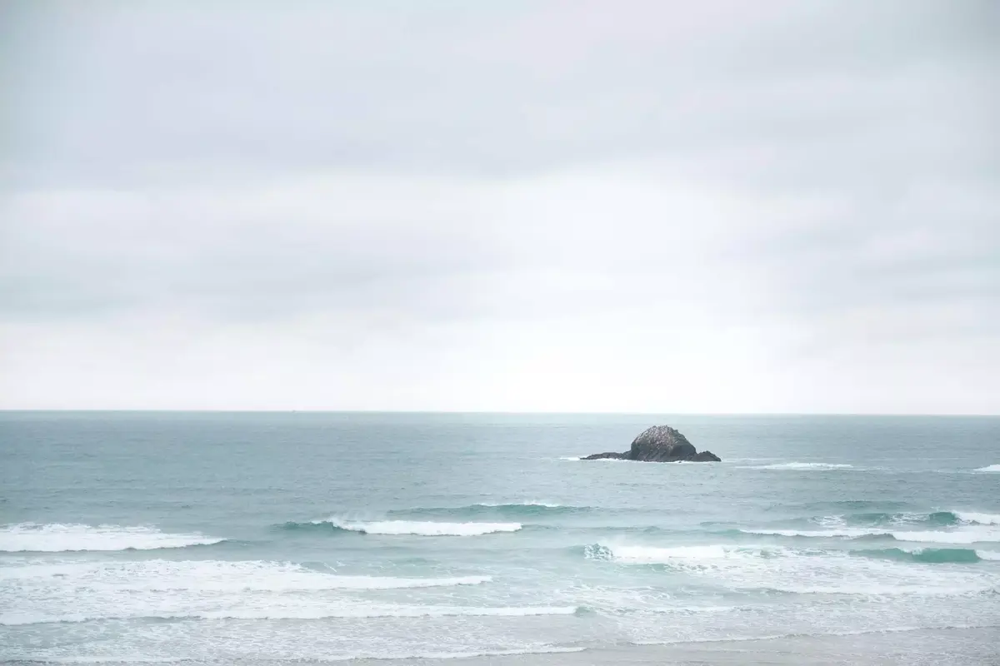

Je ne me suis jamais senti autant connecté à Mère Nature. Cela fait maintenant quelques années que nos week-ends se passent dehors. Que ce soit pour une courte marche ou une journée à vadrouiller. Cela nous permet de nous sentir connecté, trouver la paix et découvrir les merveilleuses choses que la nature a à nous offrir. On a vadrouillé un peu partout en Belgique et nous avons adoré cela.

Depuis notre déménagement en Bretagne, nous avons une connection encore plus profonde avec la nature. Même durant la pause de midi, on peut partir pour une balade à travers champs. On passe aussi beaucoup plus de temps au jardin. La pluie ne nous arrête pas du tout, elle nous permet simplement de découvrir les choses différement. La terre est magnifique sous le soleil mais pas seulement.



La cueillette, ca nous connait. Depuis aout, on a fait notre propre liqueur, différentes confitures avec tous les fruits que nous trouvions et pour Noel, Cloé a même fait de magnifiques décorations avec ce que nous trouvions dehors. J'ai hâte d'en apprendre plus sur les plantes comestibles, la cueillette aux champignons et les fruits que la nature a à partager.

Découvrir l'intérieur des terres, moins connue que la côte bretonne, est quelque chose que j'apprécie particulièrement. Pleine de surprises et de paysages variés et divers; des forêts, des rochers, des champs, des landes et autres



Vivre aussi près de la mer nous permet de payer une visite à la déesse des mers aussi souvent que notre corps nous réclame une bonne bouffée d'air saline. Je suis tombé amoureux de ces côtes sauvages et j'adore les photographier autant que possible. Je pense de plus en plus à nager dans ses eaux froides, même en hiver. J'espère aussi prendre le temps pour apprendre à surfer

Nous avons cueilli de la nourriture dans les terres, mais la mer aussi peut donner. C'est vrai que cet été, elle a plutôt pris mes lunettes, mais c'était une offrande qui paie pour toutes les choses qu'elle donne. Nous devons encore nous améliorer pour la pêche à pied et les coquillages.

Quelques rêves pour cette année nouvelle incluent de faire un hike de plusieurs jours en Bretagne ainsi que fouler plus de sentiers du GR34, connu comme étant le sentier des douaniers. Cette randonnée suit la côte et traverse tous les lieux sauvages du bord de mer.

J'ai hâte que l'année nouvelle arrive et plus spécifiquement le printemps. Pouvoir aller planter la tente pour une nuit ou deux dans les lieux les plus sauvages du coin. Cela nous permettra de découvrir encore plus. J'espère que vous appréciez mes récits et photos, car je compte bien en publier encore plus! N'hésitez pas à partager vos coups de coeurs et lieux favoris.
